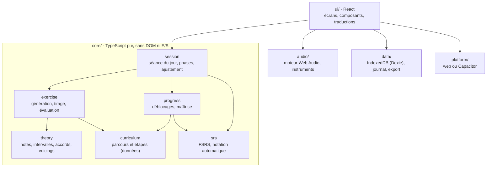

# Oreille musicale — Document de conception

> **Statut** : brouillon v0.1, à relire et valider
> **Date** : 18 novembre 2026
> **Objet** : application web et Android d'entraînement de l'oreille musicale (intervalles et accords), avec difficulté progressive, suivi de progression et révisions espacées.

## Sommaire

1. [Résumé](#1-résumé)
2. [Contexte et objectifs](#2-contexte-et-objectifs)
3. [Utilisateurs visés](#3-utilisateurs-visés)
4. [Principes pédagogiques](#4-principes-pédagogiques)
5. [Périmètre fonctionnel](#5-périmètre-fonctionnel)
6. [Contenu musical](#6-contenu-musical)
7. [Progression](#7-progression)
8. [Révisions et séance du jour](#8-révisions-et-séance-du-jour)
9. [Expérience utilisateur](#9-expérience-utilisateur)
10. [Architecture technique](#10-architecture-technique)
11. [Plan de réalisation](#11-plan-de-réalisation)
12. [Risques](#12-risques)
13. [Questions ouvertes](#13-questions-ouvertes)
14. [Annexes](#14-annexes)

---

## 1. Résumé

*Oreille musicale* est une application d'entraînement auditif pour le web et Android. Elle propose deux familles d'exercices, la **reconnaissance d'intervalles** et la **reconnaissance d'accords**, organisées en **parcours progressifs** : on part de quelques éléments très contrastés, on en ajoute un à la fois, et on passe des présentations les plus faciles (intervalles ascendants, accords arpégés) aux plus difficiles (intervalles harmoniques, accords renversés).

Chaque élément acquis entre dans un système de **révisions espacées** (algorithme FSRS) qui le refait travailler juste avant qu'il ne soit oublié. Les erreurs alimentent une **matrice de confusion** qui déclenche des exercices ciblés entre éléments souvent confondus. Au quotidien, un seul bouton suffit : la **séance du jour** (≈ 10 min) enchaîne révisions et nouvelles notions.

**Décisions structurantes**

| # | Décision | Raison |
|---|---|---|
| D1 | Une seule base de code **TypeScript + React**, publiée en **PWA** sur le web et empaquetée pour **Android avec Capacitor** | Un seul code à maintenir ; Web Audio couvre le besoin ; accès aux fonctions natives (notifications) |
| D2 | **Local-first**, sans compte en v1 ; un **journal d'événements** est la source de vérité | Hors-ligne, confidentialité, simplicité ; recalculs et synchronisation future facilités |
| D3 | Questions **générées** à la volée (fondamentale, registre, orthographe) et jouées par un **échantillonneur de piano** | Entraîner l'oreille relative plutôt que la mémoire de sons précis |
| D4 | Progression en **grille** (éléments × modes de jeu), chaque étape en 4 phases : découverte → comparaison → entraînement → validation | Difficulté progressive et lisible, sans marche trop haute |
| D5 | Révisions par **compétence** (ex. « tierce mineure descendante ») avec **FSRS** et une **note calculée automatiquement** | Planification éprouvée, adaptée à des questions toujours renouvelées |
| D6 | **Cœur métier en TypeScript pur** (théorie, génération, progression, révisions), testé indépendamment de l'interface et de l'audio | Fiabilité et testabilité |

---

## 2. Contexte et objectifs

### 2.1 Contexte

Reconnaître intervalles et accords à l'oreille sert à jouer d'oreille, relever des morceaux, improviser ou réussir ses examens de formation musicale. Cette compétence se construit par une pratique **courte, régulière et progressive**. L'appli combine trois choses : un parcours guidé, une vraie répétition espacée et un travail ciblé sur ses propres confusions, le tout en français et hors-ligne.

### 2.2 Objectifs

- **O1** — Reconnaître les 12 intervalles simples, ascendants, descendants et harmoniques.
- **O2** — Reconnaître les principaux accords : triades (majeur, mineur, diminué, augmenté, suspendus) et accords de septième (7, 7M, m7, ø, °7, m7M, 7sus4), y compris renversés.
- **O3** — Rendre la progression **automatique et visible** : l'appli choisit quoi travailler, on voit ce qu'on maîtrise.
- **O4** — **Retenir dans la durée** grâce aux révisions espacées.
- **O5** — Fonctionner **hors-ligne**, en séances de 5 à 15 min, sur téléphone comme sur ordinateur.
- **O6** — Interface et terminologie **françaises** (Do Ré Mi, 3M, 5J…) ; anglais possible plus tard.

### 2.3 Non-objectifs de la v1

- Dictée mélodique, rythme, réponse chantée (détection de hauteur au micro).
- Écoute fonctionnelle (degrés, cadences, enchaînements d'accords) : piste prioritaire pour la v2.
- Application iOS native (la PWA reste utilisable sur iPhone).
- Comptes, synchronisation, fonctions sociales, monétisation.

### 2.4 Indicateurs de réussite

- Pratique au moins 5 jours par semaine sur la durée.
- Taux de réussite observé en révision proche de la rétention cible (≈ 90 %) : signe que la planification est bien calibrée.
- Nombre de compétences « consolidées » et « maîtrisées » en hausse continue.
- Aucun défaut audio perceptible (clics, décalages, coupures) sur les appareils de test.

---

## 3. Utilisateurs visés

| Profil | Besoins | Conséquences pour l'appli |
|---|---|---|
| **Débuter de zéro** (amateur, autodidacte) | Être guidé, ne pas se décourager, séances courtes | Parcours guidé, chansons repères, feedback pédagogique, séance du jour |
| **Préparer la formation musicale** (école de musique, conservatoire) | Intervalles, accords et renversements avec le vocabulaire des cours | Terminologie française exacte (4J, 5−, septième de dominante…), convention Do3 = do central |
| **Entretenir et approfondir** (jazz, accompagnement) | Accords de septième, renversements, entretien des acquis | Test de positionnement, révisions, entraînement libre paramétrable |

Contexte d'usage principal : une séance quotidienne de 5 à 15 min, souvent sur téléphone avec écouteurs, parfois sur ordinateur au clavier.

---

## 4. Principes pédagogiques

Chaque fonctionnalité doit pouvoir se rattacher à l'un de ces principes.

1. **Du contraste à la nuance.** Commencer par des éléments très différents (tierce majeure, quinte, octave), ajouter un élément à la fois et le confronter d'abord à son voisin le plus proche (4J contre 5J, 3m contre 3M).
2. **Variabilité.** Fondamentale et registre changent à chaque question (puis timbre et tempo) : on apprend à reconnaître une *relation* entre des notes, pas un son précis.
3. **Pratique entrelacée.** Dès qu'un élément est introduit, il est mélangé aux autres : on apprend mieux à discriminer en alternant qu'en répétant un même élément en bloc (Kornell & Bjork, 2008).
4. **Récupération active et feedback contrastif.** Chaque question appelle une réponse (Roediger & Karpicke, 2006) ; après une erreur, on réentend la bonne réponse **et** la sienne, sur la même fondamentale.
5. **Répétition espacée.** Ce qui est acquis revient à intervalles croissants, juste avant l'oubli (Cepeda et al., 2006).
6. **Difficulté désirable.** En apprentissage, viser 80 à 85 % de réussite (Wilson et al., 2019) : au-dessus, on ajoute de la variabilité ; en dessous, on simplifie.
7. **Peu mais souvent.** Des séances courtes et quotidiennes plutôt que longues et rares.
8. **Échafaudages amovibles.** Les aides (chansons repères, réécoute, arpège d'un accord plaqué) sont là au début puis s'effacent ; leur usage est pris en compte dans l'évaluation.

---

## 5. Périmètre fonctionnel

### 5.1 Version 1

| Fonction | Description | Priorité |
|---|---|---|
| Intervalles | 12 intervalles simples ; ascendants, descendants, harmoniques | Indispensable |
| Accords | Triades et septièmes ; reconnaissance de la qualité (même renversée) et identification du renversement | Indispensable |
| Parcours progressifs | Étapes débloquées en grille, 4 phases par étape (§7) | Indispensable |
| Révisions espacées | FSRS par compétence, notation automatique (§8) | Indispensable |
| Séance du jour | Révisions dues + duels + étape en cours, ≈ 10 min (§8.7) | Indispensable |
| Feedback contrastif | Écoute comparée bonne réponse / réponse donnée, notes affichées sur un mini-clavier | Indispensable |
| Hors-ligne | PWA (web), application installable (Android) | Indispensable |
| Statistiques | Grille de maîtrise, matrice de confusion, historique, série | Important |
| Entraînement libre | Choix des éléments, modes, registre, tempo, nombre de questions | Important |
| Sauvegarde | Export / import d'un fichier JSON | Important |
| Tests de positionnement | Valider d'emblée les étapes déjà maîtrisées (§7.6) | Important |
| Rappels | Une notification quotidienne (Android) | Souhaitable |
| Chansons repères | Mnémotechniques par intervalle, personnalisables | Souhaitable |
| Timbres supplémentaires | Son pur d'abord, puis guitare, cordes, orgue… | Souhaitable |

### 5.2 Pistes pour la suite

- Écoute fonctionnelle : degrés dans une tonalité, cadences, enchaînements (II–V–I…).
- Accords enrichis (6, 9, 11, 13, altérations), voicings ouverts et drop 2.
- Intervalles composés (au-delà de l'octave), gammes et modes.
- Synchronisation entre appareils (compte optionnel).
- Réponse chantée ou jouée (détection de hauteur), dictée mélodique, rythme.
- Interface en anglais.

---

## 6. Contenu musical

> **Convention de ce document** : les registres techniques sont notés en notation scientifique anglo-saxonne (C4 = do central, A4 = 440 Hz). L'interface utilisera par défaut la convention française (Do3 = do central, La3 = 440 Hz).

### 6.1 Intervalles

Les codes servent d'identifiants internes ; l'interface affiche l'abréviation française et le nom complet.

| Code | ½ tons | Nom | Abrév. | Exemple | Repère ascendant\* | Repère descendant\* |
|---|---|---|---|---|---|---|
| `m2` | 1 | Seconde mineure | 2m | Do → Ré♭ | *Les Dents de la mer* | *La Lettre à Élise* |
| `M2` | 2 | Seconde majeure | 2M | Do → Ré | *Frère Jacques* | *Yesterday* |
| `m3` | 3 | Tierce mineure | 3m | Do → Mi♭ | *Smoke on the Water* | *Hey Jude* |
| `M3` | 4 | Tierce majeure | 3M | Do → Mi | *When the Saints* | *5e Symphonie* (Beethoven) |
| `P4` | 5 | Quarte juste | 4J | Do → Fa | *La Marseillaise* | *Une petite musique de nuit* |
| `TT` | 6 | Triton (quarte augmentée / quinte diminuée) | 4+ / 5− | Do → Fa♯ | *Les Simpson* | — |
| `P5` | 7 | Quinte juste | 5J | Do → Sol | *Ah ! vous dirai-je, maman* | *Les Pierrafeu* |
| `m6` | 8 | Sixte mineure | 6m | Do → La♭ | — | — |
| `M6` | 9 | Sixte majeure | 6M | Do → La | *My Bonnie* | — |
| `m7` | 10 | Septième mineure | 7m | Do → Si♭ | *Star Trek* (série originale) | — |
| `M7` | 11 | Septième majeure | 7M | Do → Si | — | — |
| `P8` | 12 | Octave juste | 8J | Do → Do | *Over the Rainbow* | — |

\* Suggestions à vérifier une à une avant intégration. L'utilisateur pourra saisir ses propres repères : les plus efficaces sont des airs qu'on connaît bien.

### 6.2 Accords

**Triades**

| Code | Nom | Symboles | ½ tons | Sur Do |
|---|---|---|---|---|
| `maj` | Accord parfait majeur | Do · C | 0-4-7 | Do Mi Sol |
| `min` | Accord parfait mineur | Dom · Cm | 0-3-7 | Do Mi♭ Sol |
| `dim` | Accord de quinte diminuée | Do° · Cdim | 0-3-6 | Do Mi♭ Sol♭ |
| `aug` | Accord de quinte augmentée | Do+ · Caug | 0-4-8 | Do Mi Sol♯ |
| `sus4` | Accord suspendu (quarte) | Dosus4 · Csus4 | 0-5-7 | Do Fa Sol |
| `sus2` | Accord suspendu (seconde) | Dosus2 · Csus2 | 0-2-7 | Do Ré Sol |

**Accords de septième**

| Code | Nom | Symboles | ½ tons | Sur Do |
|---|---|---|---|---|
| `dom7` | Septième de dominante | Do7 · C7 | 0-4-7-10 | Do Mi Sol Si♭ |
| `maj7` | Septième majeure | Do7M · Cmaj7 | 0-4-7-11 | Do Mi Sol Si |
| `m7` | Mineur septième | Dom7 · Cm7 | 0-3-7-10 | Do Mi♭ Sol Si♭ |
| `m7b5` | Demi-diminué (septième de sensible) | Doø · Cm7♭5 | 0-3-6-10 | Do Mi♭ Sol♭ Si♭ |
| `dim7` | Septième diminuée | Do°7 · Cdim7 | 0-3-6-9 | Do Mi♭ Sol♭ Si♭♭ |
| `mmaj7` | Mineur septième majeure | Dom7M · Cm(maj7) | 0-3-7-11 | Do Mi♭ Sol Si |
| `7sus4` | Septième suspendue | Do7sus4 · C7sus4 | 0-5-7-10 | Do Fa Sol Si♭ |

**Renversements** : état fondamental (basse = fondamentale), 1er renversement (basse = tierce), 2e (basse = quinte), 3e pour les septièmes (basse = septième). Deux types d'exercices :

- reconnaître la **qualité** d'un accord quel que soit son renversement ;
- identifier le **renversement** lui-même.

Les accords **symétriques** (augmenté, septième diminuée) et **suspendus** sont exclus de l'identification du renversement, et les suspendus de la reconnaissance de qualité en renversement : leurs renversements sont indiscernables, à l'oreille, d'autres accords à l'état fondamental (Dosus4 renversé donne Fa–Sol–Do, c'est-à-dire Fasus2).

### 6.3 Modes de jeu

| Famille | Modes, du plus facile au plus difficile |
|---|---|
| Intervalles | mélodique ascendant (`asc`) → mélodique descendant (`desc`) → harmonique, notes simultanées (`harm`) |
| Accords | arpégé montant (`arp`) → plaqué à l'état fondamental (`block`) → plaqué renversé (`inv`) → voicings ouverts (expert, v2) |

### 6.4 Génération d'une question

Une question est produite à partir d'une **compétence** (ex. `int:m3:asc`) et des **paramètres de l'étape**. Sa version concrète s'appelle une **réalisation**.

1. **Fondamentale** tirée au hasard dans le registre autorisé (F3–F5 au début pour les intervalles, élargi jusqu'à C3–C6), différente de celle de la question précédente.
2. **Registre grave** : jamais d'intervalle d'une tierce ou moins entre deux voix sous C3 (le son devient confus) ; basse des accords en position serrée entre C3 et C4.
3. **Orthographe** : notes écrites de façon à limiter les altérations, sans double altération sauf dans la septième diminuée. Une 3m sur Do s'affiche Do → Mi♭, jamais Do → Ré♯.
4. **Voicing** : position serrée ; les renversements sont obtenus par rotation, la basse étant tirée dans le registre autorisé.
5. **Durées** (tempo normal) : note mélodique 0,9 s + 0,1 s de silence ; intervalle harmonique 1,8 s ; accord plaqué 2 s ; arpège 0,45 s entre les notes, notes tenues jusqu'à la fin. Tempo lent ×1,4, rapide ×0,7.
6. **Nuance** constante (vélocité moyenne) ; légère variation aléatoire en mode expert.

Le hasard passe par un **générateur pseudo-aléatoire initialisable** (graine), injecté : les tests sont reproductibles et les bugs rejouables.

---

## 7. Progression

### 7.1 Vocabulaire

- **Élément** : ce qu'on reconnaît (tierce mineure, accord m7…).
- **Mode** : la façon de le faire entendre (ascendant, harmonique, plaqué…).
- **Compétence** : un élément dans un mode, ex. « tierce mineure ascendante » (`int:m3:asc`). C'est l'unité de suivi et de révision.
- **Étape** : une leçon qui introduit en général **un** nouvel élément dans un mode, au milieu d'un ensemble de réponses possibles.
- **Parcours** : une grille d'étapes (Intervalles, Triades, Septièmes, Renversements).

### 7.2 Grilles de progression

En colonnes, l'ensemble des réponses s'agrandit d'un élément à la fois ; en lignes, les modes vont du plus facile au plus difficile. **Une étape se débloque quand l'étape à sa gauche et l'étape au-dessus sont validées.** On progresse ainsi sur plusieurs fronts à la fois, sans jamais sauter de marche.

```
              1        2        3        4        5
              3M·5J·8J +4J      +3m      +2M      +2m      …
Ascendant     [x] ──── [x] ──── [x] ──── [>] ──── [ ]      …
               │        │        │        │        │
Descendant    [x] ──── [x] ──── [>] ──── [ ] ──── [ ]      …
               │        │        │        │        │
Harmonique    [x] ──── [>] ──── [ ] ──── [ ] ──── [ ]      …

[x] validée    [>] disponible    [ ] verrouillée
```

**Parcours Intervalles** : 3 lignes (`asc`, `desc`, `harm`) × 10 colonnes = 30 étapes.

| Col. | Ajout | Réponses possibles | Comparé à |
|---|---|---|---|
| 1 | 3M, 5J, 8J | 3 | — |
| 2 | 4J | 4 | 5J, 3M |
| 3 | 3m | 5 | 3M |
| 4 | 2M | 6 | 3m |
| 5 | 2m | 7 | 2M |
| 6 | 6M | 8 | 5J |
| 7 | 6m | 9 | 6M, 5J |
| 8 | 7m | 10 | 6M, 8J |
| 9 | 7M | 11 | 8J, 7m |
| 10 | triton | 12 | 4J, 5J |

Une fois la grille terminée s'ouvre un chapitre **Expert** : directions mélangées, registre large, tempo rapide, timbres variés ; puis les intervalles composés en v2.

**Parcours Triades** : lignes `arp`, `block`, `inv` ; 13 étapes.

| Col. | Ajout | Comparé à | Remarque |
|---|---|---|---|
| 1 | majeur, mineur | — | |
| 2 | diminué | mineur | |
| 3 | augmenté | majeur | |
| 4 | sus4 | majeur | lignes `arp` et `block` seulement |
| 5 | sus2 | sus4 | lignes `arp` et `block` seulement |

**Parcours Septièmes** : lignes `arp`, `block`, `inv` ; 17 étapes ; débloqué par l'étape Triades `block` colonne 2.

| Col. | Ajout | Comparé à | Remarque |
|---|---|---|---|
| 1 | 7, 7M | — | |
| 2 | m7 | 7 | |
| 3 | ø (m7♭5) | m7 | |
| 4 | °7 | ø | |
| 5 | m7M | m7 | |
| 6 | 7sus4 | 7 | lignes `arp` et `block` seulement |

**Parcours Renversements** (accords plaqués ; on répond par le renversement) : 6 étapes.

| Étape | Accords | Réponses | Débloquée par |
|---|---|---|---|
| R1 | majeur | fondamental, 1er | Triades `block` col. 1 |
| R2 | majeur | + 2e | R1 |
| R3 | mineur | fondamental, 1er, 2e | R2 |
| R4 | majeur et mineur mêlés | fondamental, 1er, 2e | R3 |
| R5 | septième de dominante | fondamental, 1er, 2e, 3e | R4 + Septièmes `block` col. 1 |
| R6 | 7, 7M, m7 mêlés | fondamental, 1er, 2e, 3e | R5 + Septièmes `block` col. 2 |

Au total : 66 étapes. Le curriculum est une **donnée versionnée** (un fichier TypeScript), pas de la logique : on peut réordonner ou ajouter des étapes sans toucher au code.

```ts
// Intervalles ascendants, colonne 2. Les prérequis se déduisent de la position dans la grille.
const step: StepDef = {
  id: 'int.asc.02',
  track: 'intervals',
  mode: 'asc',
  answers: ['M3', 'P4', 'P5', 'P8'],
  newItems: ['P4'],
  contrast: { P4: ['P5', 'M3'] },
  generation: { range: ['F3', 'F5'], instrument: 'piano', tempo: 'normal' },
  validation: { minAccuracy: 0.9, minNewItemAccuracy: 0.75 },
};
```

### 7.3 Déroulé d'une étape

| Phase | Contenu | Passage à la suite |
|---|---|---|
| 1 · Découverte | Le nouvel élément est joué 4 fois sur des fondamentales différentes, avec son nom et sa chanson repère, puis alterné avec son voisin. Non noté. | Quand l'utilisateur le souhaite (phase facultative) |
| 2 · Comparaison | « Duel » à deux réponses : le nouvel élément contre son voisin. | 8 bonnes réponses sur les 10 dernières, ou 20 questions au plus |
| 3 · Entraînement | Tout l'ensemble de l'étape ; ≈ 40 % des questions sur le nouvel élément ; feedback complet ; difficulté ajustée (§7.5). | Dès 85 % de réussite sur les 20 dernières questions et 5 passages du nouvel élément, le test est proposé |
| 4 · Validation | Test de 4 questions par réponse possible (entre 12 et 30), dont ≈ 30 % sur le nouvel élément ; feedback bref. | Réussi avec au moins 90 % au total et 75 % sur le nouvel élément |

- Une étape peut s'étaler sur plusieurs séances : la phase en cours est sauvegardée.
- **« Je connais déjà »** : le test est accessible à tout moment, pour avancer vite.
- En cas d'échec, retour à l'entraînement avec les éléments ratés surpondérés.
- En colonne 1, tous les éléments sont nouveaux (pas de comparaison) ; une étape sans nouvel élément (R4) se limite à l'entraînement et au test.
- À la validation, les nouvelles compétences entrent dans les révisions (§8.2).

### 7.4 Niveaux de maîtrise

| Niveau | Condition |
|---|---|
| 0 · Non vue | Pas encore introduite |
| 1 · En apprentissage | Introduite dans une étape non validée |
| 2 · Acquise | Étape validée ; stabilité FSRS inférieure à 7 jours |
| 3 · Consolidée | Stabilité de 7 à 30 jours |
| 4 · Maîtrisée | Stabilité d'au moins 30 jours |
| Marque « fragile » | Dernière révision ratée, ou moins de 70 % sur les 10 dernières réponses |

La **stabilité** (au sens de FSRS) est le nombre de jours au bout duquel la probabilité de se souvenir tombe à 90 %.

### 7.5 Ajustement de la difficulté en entraînement

- Selon le taux de réussite sur les 10 dernières questions :
  - **moins de 65 %** : on simplifie temporairement (tempo lent, registre resserré, duel sur la confusion la plus fréquente) ;
  - **de 65 à 90 %** : zone cible, rien ne change ;
  - **plus de 90 %** : on ajoute de la variabilité (registre élargi, tempo plus rapide, puis timbres variés quand ils existeront).
- **Tirage pondéré** : poids d'un élément = 1 + 2 × taux d'erreur récent (lissé) + bonus « nouvel élément » + bonus « pas entendu depuis longtemps ». Jamais plus de 3 fois la même réponse d'affilée.
- Les **réponses proposées** sont toujours l'ensemble complet de l'étape (pas de QCM réduit à 4 choix) : la discrimination reste réelle.

### 7.6 Tests de positionnement

Chaque parcours a son test, proposé au premier lancement (« J'ai déjà des bases ») puis accessible depuis l'écran du parcours. Il avance par paliers (pour les intervalles : colonnes 1, 4, 7 et 10, ligne par ligne), à raison de 6 questions par palier, et s'arrête au premier palier sous 5/6. Les étapes jusqu'au dernier palier réussi sont validées et leurs compétences entrent en révision. Durée : 10 min au plus.

---

## 8. Révisions et séance du jour

### 8.1 Principe

- L'unité de révision est la **compétence** (ex. `int:m6:desc`), pas une question figée : chaque révision génère de nouvelles réalisations.
- Algorithme : **FSRS** via la bibliothèque `ts-fsrs`, rétention cible **90 %**, paramètres par défaut, puis optimisés sur l'historique de l'utilisateur quand il sera suffisant (v2).
- FSRS ne planifie qu'**entre les jours** ; la répétition au sein d'une journée est assurée par les étapes et les séances.
- Le « jour » commence à 4 h du matin (heure locale), pour qu'une séance tardive compte pour la veille.

### 8.2 Entrée en révision

À la validation d'une étape, chaque nouvelle compétence reçoit une première note FSRS : *Bien* si elle a obtenu au moins 90 % pendant le test, *Difficile* sinon. Sa première révision tombe alors un à trois jours plus tard.

### 8.3 Note automatique

FSRS attend une note parmi *À revoir*, *Difficile*, *Bien* et *Facile*. En révision, chaque compétence due est posée **3 fois** (réalisations différentes, mélangées avec d'autres questions) ; la note se calcule ainsi :

| Résultat des 3 questions | Note |
|---|---|
| 0 ou 1 bonne réponse | À revoir (*Again*) |
| 2 bonnes réponses | Difficile (*Hard*) |
| 3 bonnes, mais lentes (temps médian > 1,5 × référence) ou avec aides | Difficile (*Hard*) |
| 3 bonnes, temps normal | Bien (*Good*) |
| 3 bonnes, rapides (temps médian < 0,6 × référence) et sans aide | Facile (*Easy*) |

- **Temps de réponse** : de la fin de la première écoute jusqu'à la réponse, corrigé de la latence de sortie audio quand le navigateur la fournit (utile avec des écouteurs Bluetooth).
- **Référence** : temps médian personnel des bonnes réponses dans le même contexte (au départ : 3 s pour les intervalles, 4 s pour les accords).
- **Aides** : plus d'une réécoute, « écouter arpégé ».

### 8.4 Séance de révision

1. **Sélection** des compétences dues, les plus en retard d'abord, **8 au maximum** par séance (réglable). Après une longue absence, le retard est étalé sur plusieurs jours, en commençant par les compétences fragiles.
2. **Regroupement par contexte de réponse** (famille + mode, ex. « intervalles descendants »), car les boutons de réponse doivent être homogènes.
3. **Mélange** : les 3 questions de chaque compétence due sont entrelacées avec ≈ 30 % de questions « distractrices » portant sur les autres compétences acquises du même contexte ; sans elles, la réponse serait devinable.
4. **Réponses proposées** : toutes les compétences acquises du contexte.
5. **Fin de séance** : chaque compétence due reçoit sa note FSRS et donc sa nouvelle échéance. Une note *À revoir* rend la compétence fragile et programme un duel ciblé.

Durée typique : 8 compétences × 3 questions + distracteurs, soit ≈ 35 questions et 5 min.

### 8.5 Révisions implicites

Une compétence **due** pratiquée au moins 3 fois le même jour dans une autre activité (étape, entraînement libre) est considérée comme révisée, avec la même règle de notation : pas de travail en double. La pratique d'une compétence non due ne modifie pas son planning, pour ne pas fausser FSRS, mais elle alimente les statistiques et la matrice de confusion.

### 8.6 Matrice de confusion et duels

- Pour chaque contexte de réponse, on compte les couples (élément joué → élément répondu) sur les 60 derniers jours.
- Un couple devient une **confusion active** s'il totalise au moins 3 erreurs et 20 % des réponses à cet élément sur ses 20 dernières apparitions.
- Une confusion active déclenche un **duel** (deux réponses, 10 questions, écoute comparée systématique) dans la prochaine séance du jour, et renforce la paire dans les tirages.
- Les statistiques affichent la matrice en carte de chaleur et les trois confusions principales (« Tu confonds souvent 6M et 7m »).

### 8.7 Séance du jour

Elle est composée automatiquement pour durer le temps de l'objectif quotidien (10 min par défaut) :

1. **révisions** dues (§8.4) ;
2. **duels** en attente (deux au maximum) ;
3. **étape en cours** : l'étape disponible la plus ancienne (lignes du haut d'abord), reprise à sa phase ;
4. s'il reste du temps, une deuxième étape disponible.

La séance s'arrête proprement à la fin d'un bloc quand l'objectif est atteint ; on peut toujours continuer.

---

## 9. Expérience utilisateur

### 9.1 Écrans

| Écran | Contenu |
|---|---|
| Accueil | Bouton « Séance du jour » avec son contenu (ex. « 6 révisions · Intervalles descendants : + 2m ») ; série, objectif du jour ; accès aux parcours, à l'entraînement libre et aux statistiques |
| Parcours | Les grilles (§7.2) avec l'état de chaque étape et la progression globale |
| Étape | Phase en cours, accès direct au test (« Je connais déjà ») |
| Exercice | Écran de question commun à tous les exercices (§9.2) |
| Bilan | Score, compétences en progrès, confusions repérées, prochaines révisions |
| Entraînement libre | Famille, éléments, modes, registre, tempo, timbre, nombre de questions ; préréglages enregistrables |
| Statistiques | Grille de maîtrise, matrice de confusion, courbes de réussite et de temps par compétence, calendrier d'activité |
| Réglages | Notation, convention d'octave, timbre, tempo, volume, passage automatique, objectif, rappel, chansons repères, thème, export/import, réinitialisation, crédits |
| Premier lancement | Présentation, test audio, préférences, niveau (§9.3) |

### 9.2 Écran d'exercice

```
┌────────────────────────────────────────┐
│ ←  Intervalles ascendants · étape 4    │
│ ██████████████░░░░░░░░░░      11 / 20  │
│                                        │
│             [ Réécouter ]              │
│                                        │
│      [ 2M ]     [ 3m ]     [ 3M ]      │
│      [ 4J ]     [ 5J ]     [ 8J ]      │
│                                        │
└────────────────────────────────────────┘

Après une erreur :
┌────────────────────────────────────────┐
│ Non : c'était une tierce majeure (3M)  │
│ Ta réponse : quarte juste (4J)         │
│                                        │
│ Ré → Fa♯                [mini-clavier] │
│                                        │
│ [ Écouter 3M ]    [ Écouter 4J ]       │
│                         [ Suivant → ]  │
└────────────────────────────────────────┘
```

- Le son part dès l'affichage de la question (les navigateurs exigent un premier geste de l'utilisateur : il a lieu au démarrage de la séance).
- Boutons dans un **ordre fixe** (par taille d'intervalle, par famille d'accords) pour créer des automatismes ; abréviation, et nom complet si la place le permet.
- **Bonne réponse** : confirmation brève, passage automatique à la question suivante (désactivable).
- **Erreur** : panneau de correction avec les notes jouées (nommées et sur un mini-clavier) et l'**écoute comparée** des deux réponses sur la même fondamentale.
- Le feedback ne repose jamais sur la couleur seule (icône + texte).
- **Aides** (prises en compte dans la note) : réécouter ; « écouter arpégé » pour un accord plaqué.
- **Clavier** (web) : Espace pour réécouter, rangée des chiffres pour répondre, Entrée pour continuer. Les touches sont lues par position physique (`KeyboardEvent.code`) pour fonctionner en AZERTY sans Maj.
- **Android** : retour haptique léger en cas d'erreur (désactivable).

### 9.3 Premier lancement

1. Présentation en deux écrans : écouter, répondre, revenir chaque jour.
2. **Test audio** : un son de piano, réglage du volume, conseil d'utiliser des écouteurs.
3. **Préférences** : Do Ré Mi ou C D E ; Do3 ou C4 comme do central.
4. **Niveau** : « Je débute » (étape 1) ou « J'ai déjà des bases » (tests de positionnement).
5. **Objectif quotidien** (5, 10 ou 15 min) et rappel (Android).

### 9.4 Motivation

- Un seul bouton pour la séance du jour : l'appli décide quoi travailler.
- Objectif quotidien en minutes de pratique active (une pause de plus d'une minute ne compte pas), affiché sous forme d'anneau.
- **Série** de jours avec objectif atteint ; **un jour de repos par semaine** ne la casse pas : on encourage la régularité sans culpabiliser.
- Les grilles se colorent au fil des progrès.
- Pas de vies, pas de publicité, un rappel au plus par jour.

### 9.5 Terminologie et notation

- Notes : Do Ré Mi (par défaut) ou C D E.
- Octaves : convention française (Do3 = do central, La3 = 440 Hz ; par défaut) ou scientifique (C4 = do central).
- Intervalles : 2m, 2M, 3m, 3M, 4J, 4+/5−, 5J, 6m, 6M, 7m, 7M, 8J ; nom complet dans le feedback et pour les lecteurs d'écran.
- Accords : nom français et symbole (Do7M, Doø, Dom7…), notation anglo-saxonne en option (Cmaj7, Cm7♭5…).
- Ton : tutoiement, bienveillant, phrases courtes.

### 9.6 Accessibilité

- Contrastes WCAG AA, taille de texte réglable, thème clair, sombre ou système.
- Navigation complète au clavier et au lecteur d'écran (libellés complets, feedback annoncé via une région ARIA).
- Respect de `prefers-reduced-motion` ; cibles tactiles d'au moins 48 dp.

---

## 10. Architecture technique

### 10.1 Choix de la plateforme

| Option | Atouts | Limites |
|---|---|---|
| **A. Web TypeScript + PWA + Capacitor (Android)** — retenue | Une base de code ; Web Audio précis et mature ; itérations rapides ; plugins natifs (notifications, haptique) ; échantillons embarqués dans l'APK | Interface moins « native » ; WebView à valider sur les appareils modestes |
| B. Flutter (web + Android) | Interface native, performances | Lecture polyphonique d'échantillons moins simple, surtout sur le web ; bundle web lourd |
| C. React Native + Expo (+ react-native-web) | Interface native sur Android | Audio à traiter séparément côté natif et côté web, ou via des bibliothèques encore jeunes |
| D. PWA seule (+ TWA pour le Play Store) | Le plus simple | Pas de notifications locales planifiées (il faudrait un serveur de push) ; dépend du navigateur installé |

**Choix : A.** Le besoin audio (jouer quelques notes à la demande, sans réagir en temps réel à un instrument) est entièrement couvert par Web Audio, y compris dans la WebView Android ; la latence de sortie n'y est pas critique.

### 10.2 Pile technique

| Domaine | Choix | Remarques |
|---|---|---|
| Langage | TypeScript (strict) | |
| Interface | React + Vite | Svelte serait une alternative valable |
| Style | Tailwind CSS | |
| Navigation | React Router | |
| État | Zustand pour la séance en cours ; Dexie + `useLiveQuery` pour les données persistées | |
| Théorie musicale | `tonal`, encapsulé dans `core/theory` | Notes, intervalles, accords, orthographe |
| Révisions | `ts-fsrs`, encapsulé dans `core/srs` | |
| Audio | Web Audio API, échantillonneur maison | Tone.js en plan B |
| Stockage | IndexedDB via Dexie | |
| Hors-ligne | `vite-plugin-pwa` (Workbox) | |
| Android | Capacitor + plugins Local Notifications, Haptics, App | |
| Traductions | i18next | Français d'abord |
| Tests | Vitest, fast-check, Testing Library, Playwright | |
| Qualité | ESLint, Prettier, GitHub Actions | |

Les versions seront figées à l'initialisation du projet.

### 10.3 Architecture en couches



- `core` n'importe ni `ui`, ni `audio`, ni `data`, ni `platform` (règle vérifiée par ESLint).
- Le temps (`now`) et le hasard (`rng`) sont **injectés** : tout le cœur est déterministe et testable.
- `core` expose des fonctions pures du type `(état, événement) → nouvel état` ; `data` enregistre les événements et les projections.

### 10.4 Moteur audio

```ts
interface AudioEngine {
  unlock(): Promise<void>;                   // reprend l'AudioContext après un geste
  load(instrument: InstrumentId, onProgress?: (ratio: number) => void): Promise<void>;
  play(notes: NoteEvent[]): PlaybackHandle;  // planifie une réalisation complète
  stopAll(): void;
}

interface NoteEvent {
  midi: number;      // hauteur
  start: number;     // secondes, relatif au début de la réalisation
  duration: number;  // secondes
  velocity: number;  // 0..1
}
```

- Le cœur produit des `NoteEvent` ; le moteur se contente de les jouer. La logique musicale se teste donc sans audio.
- **Échantillonneur** : un échantillon tous les 3 demi-tons ; les autres notes sont obtenues en variant la vitesse de lecture (`playbackRate = 2^(écart/12)`, un demi-ton d'écart au plus). Échantillons normalisés en volume ; enveloppe (attaque ≈ 5 ms, relâchement ≈ 250 ms) contre les clics ; compresseur-limiteur en sortie pour les accords.
- **Piano** : échantillons *Salamander Grand Piano* (licence CC BY 3.0), une ou deux couches de vélocité, de A1 à C7, en MP3 (décodable partout, Safari compris) : 1 à 2 Mo.
- **Son pur** (oscillateur avec enveloppe) : aucun téléchargement, sert de repli.
- **Planification** : tous les événements d'une réalisation sont programmés d'un coup sur l'horloge audio ; une nouvelle lecture coupe la précédente par un fondu court.
- **Chargement** paresseux par instrument, avec indicateur de progression ; tampons décodés gardés en mémoire.
- **Cycle de vie** : son coupé quand l'appli passe en arrière-plan, `AudioContext` repris au retour.
- **Android** : `setVolumeControlStream(AudioManager.STREAM_MUSIC)` dans `MainActivity`, pour que les touches de volume règlent le volume média.

### 10.5 Modèle de données

Un **journal d'événements en ajout seul** est la source de vérité ; les états (cartes FSRS, maîtrise, déblocages, matrice de confusion) sont des **projections** recalculables. On peut ainsi corriger une règle de notation et tout recalculer, migrer sans perte, et préparer la synchronisation par simple fusion de journaux.

```ts
type CompetenceId = string; // 'int:m3:asc', 'chd:m7b5:block', 'inv:maj:1'
type StepId = string;       // 'int.asc.04', 'tri.block.02', 'sev.inv.03', 'inv.R2'

// ——— Journal (source de vérité) ———

interface SessionRecord {
  id: string;
  kind: 'daily' | 'custom';
  startedAt: number;             // horodatage (ms)
  endedAt?: number;
  appVersion: string;
  curriculumVersion: string;
}

interface Attempt {
  id: string;
  sessionId: string;
  at: number;
  activity: 'contrast' | 'train' | 'test' | 'review' | 'duel' | 'free' | 'placement';
  stepId?: StepId;
  competenceId: CompetenceId;    // ce qui a été joué
  rendition: {
    midi: number[];
    spelling: string[];          // ex. ['D4', 'F#4']
    mode: PlaybackMode;
    instrument: InstrumentId;
    tempo: Tempo;
  };
  choices: string[];             // réponses proposées
  answer: string;                // réponse donnée
  correct: boolean;
  responseTimeMs: number;
  replays: number;
  helpUsed: boolean;             // ex. « écouter arpégé »
}

interface ProgressEvent {
  id: string;
  at: number;
  type: 'step_validated' | 'placement_passed' | 'competence_reset';
  stepId?: StepId;
  competenceIds?: CompetenceId[];
  score?: number;
}

interface ReviewLog {
  id: string;
  at: number;
  competenceId: CompetenceId;
  grade: 1 | 2 | 3 | 4;          // À revoir | Difficile | Bien | Facile
  source: 'review' | 'implicit' | 'validation' | 'placement';
  attemptIds: string[];
}

// ——— Projections (recalculables) ———

interface CompetenceState {
  id: CompetenceId;
  introducedAt: number;
  card?: FsrsCard;               // échéance, stabilité, difficulté, répétitions, oublis
  recent: boolean[];             // 20 dernières réponses
  medianResponseTimeMs?: number;
  fragile: boolean;
}

interface StepState {
  id: StepId;
  status: 'locked' | 'available' | 'in_progress' | 'validated';
  phase?: 'discover' | 'contrast' | 'train' | 'test';
  bestScore?: number;
}

// ——— Réglages ———

interface Settings {
  noteNames: 'fr' | 'en';
  octaveConvention: 'fr' | 'scientific';
  instrument: InstrumentId;
  tempo: Tempo;                  // 'slow' | 'normal' | 'fast'
  volume: number;
  autoAdvance: boolean;
  dailyGoalMinutes: number;
  reminder: { enabled: boolean; time: string };  // '19:00'
  mnemonics: Record<string, string>;             // chansons repères personnalisées
  haptics: boolean;
  theme: 'system' | 'light' | 'dark';
}
```

Volumétrie : environ 100 réponses par jour, soit près de 36 000 par an (quelques Mo), sans difficulté pour IndexedDB.

### 10.6 Persistance, sauvegarde et hors-ligne

- IndexedDB (Dexie) avec schéma versionné et migrations ; sur le web, demande de stockage persistant (`navigator.storage.persist()`) pour éviter l'éviction par le navigateur.
- **Export / import** d'un fichier JSON (journal, réglages, version de schéma) ; l'import remplace les données après confirmation.
- **Web** : un service worker met en cache l'application et, à leur première utilisation, les échantillons ; l'appli fonctionne ensuite hors-ligne.
- **Android** : application et échantillons sont embarqués ; hors-ligne dès l'installation.

### 10.7 Spécificités Android

- Notifications locales : un rappel quotidien à l'heure choisie, seulement si des révisions sont dues ou si l'objectif n'est pas atteint.
- Bouton retour : navigation interne ; confirmation avant de quitter une séance.
- Portrait par défaut ; paysage accepté sur tablette.
- Passage en arrière-plan : séance en pause, son coupé.
- **Publication sur le Play Store** : compte développeur (frais d'inscription uniques), politique de confidentialité, formulaire « Sécurité des données » (aucune donnée collectée). Les comptes personnels récents doivent d'abord mener un **test fermé** (à ce jour : 12 testeurs pendant 14 jours). À anticiper, ou distribuer l'APK directement en attendant.

### 10.8 Synchronisation (v2)

Pas de synchronisation en v1 : l'export/import permet de passer d'un appareil à l'autre. Le journal en ajout seul la rend simple à ajouter plus tard : chaque appareil envoie ses événements (identifiants uniques), récupère ceux des autres et recalcule ses projections. Backend envisageable : Supabase (Postgres + authentification, hébergement en UE) ou un petit serveur maison.

### 10.9 Organisation du dépôt

```
oreille-musicale/
├── docs/
│   ├── DESIGN.md            ← ce document
│   └── adr/                 ← décisions d'architecture, une par fichier
├── src/
│   ├── core/                ← TypeScript pur, couvert par les tests
│   │   ├── theory/
│   │   ├── curriculum/      ← parcours et étapes (données)
│   │   ├── exercise/
│   │   ├── session/
│   │   ├── progress/
│   │   └── srs/
│   ├── audio/
│   ├── data/
│   ├── platform/
│   ├── ui/
│   │   ├── screens/
│   │   ├── components/
│   │   └── i18n/
│   └── main.tsx
├── public/
│   └── samples/piano/       ← échantillons et leur licence
├── android/                 ← projet natif généré par Capacitor
├── e2e/                     ← tests Playwright
├── capacitor.config.ts
├── vite.config.ts
└── package.json
```

### 10.10 Qualité et livraison

- **Tests unitaires** (Vitest) sur tout `core` : orthographe correcte pour toutes les fondamentales, contraintes de registre, règles de déblocage, notation FSRS, ajustement de la difficulté.
- **Tests de propriétés** (fast-check) : quelle que soit la graine, une réalisation respecte son registre, la bonne réponse figure parmi les choix, etc.
- **Tests de composants** (Testing Library) et **de bout en bout** (Playwright) avec un moteur audio factice et une horloge simulée : premier lancement → étape 1 → validation → révision le lendemain.
- **Recette audio manuelle** : Chrome, Firefox et Safari sur ordinateur ; un Android d'entrée de gamme et un de milieu de gamme.
- **Intégration continue** (GitHub Actions) : lint, typage, tests et build à chaque push ; déploiement web automatique depuis `main` ; APK de test en artefact.
- **Budgets** : JS initial ≤ 250 Ko compressé ; échantillons de piano ≤ 3 Mo ; son audible ≤ 150 ms après le geste ; appli interactive en moins de 3 s sur un Android de milieu de gamme.

### 10.11 Confidentialité, sécurité et licences

- Aucune donnée ne quitte l'appareil en v1 : ni compte, ni traceur, ni publicité.
- Politique de confidentialité courte (exigée par le Play Store).
- En-têtes de sécurité (CSP) sur l'hébergement web ; dépendances surveillées (Dependabot).
- Crédits des échantillons et des bibliothèques dans l'appli et dans un fichier dédié.

---

## 11. Plan de réalisation

| Jalon | Contenu | Terminé quand… |
|---|---|---|
| **J0 · Fondations** | Projet Vite + React + TS, outillage, CI, déploiement de prévisualisation ; `core/theory` testé ; prototype audio (son pur + piano) ; **essai sur un vrai téléphone Android via Capacitor** pour lever au plus tôt le risque audio | Un bouton joue un intervalle aléatoire correctement nommé, sur le web et sur Android |
| **J1 · Premier exercice** | Génération d'intervalles, écran d'exercice, feedback contrastif, journal des réponses | Une série de 20 questions est jouable de bout en bout |
| **J2 · Parcours Intervalles** | Curriculum en grille, 4 phases, déblocages, écran Parcours, accueil | On progresse de l'étape 1 à 10 en ascendant |
| **J3 · Révisions** | FSRS, notation automatique, séance de révision, révisions implicites, matrice de confusion, duels, séance du jour | Avec une horloge simulée, les compétences reviennent aux bonnes dates |
| **J4 · Accords** | Triades, septièmes, renversements | Les trois parcours d'accords sont jouables |
| **J5 · Android et hors-ligne** | PWA, build Capacitor, notifications, export/import, test fermé | L'appli s'installe et fonctionne en mode avion |
| **J6 · Finitions** | Tests de positionnement, chansons repères, statistiques complètes, accessibilité, autres timbres | Version 1.0 |

---

## 12. Risques

| Risque | Impact | Parade |
|---|---|---|
| Audio insuffisant (qualité, latence) dans la WebView Android | Élevé | Essai réel dès J0 ; l'interface `AudioEngine` permet un plan B natif (plugin Capacitor) |
| Poids des échantillons | Moyen | Un échantillon par tierce mineure, 1 ou 2 couches de vélocité, MP3, chargement paresseux |
| Licences des sons | Élevé si négligé | Sources sous licence libre uniquement (CC0, CC BY), crédits affichés |
| Planification FSRS mal adaptée à l'entraînement auditif | Moyen | Journal complet, donc règles ajustables et recalculables ; suivi du taux de réussite réel en révision |
| Perte des données locales (désinstallation, nettoyage) | Élevé | Stockage persistant, export/import, synchronisation en v2 |
| Lassitude, abandon | Moyen | Séances courtes, séance du jour, progrès visibles |
| Dérive du périmètre | Moyen | v1 limitée aux intervalles simples et aux accords ; le reste attend en backlog |
| Contraintes de publication sur le Play Store | Faible | Les anticiper ; APK direct en attendant |

---

## 13. Questions ouvertes

1. **Pour qui ?** D'abord pour toi, ou pour un public (élèves, amis, Play Store) ? Cela change l'effort sur l'accueil, la publication et la traduction.
2. **Synchronisation web ↔ Android** dès la v1, ou l'export/import suffit-il au début ?
3. **Framework** : React te convient-il, ou as-tu une préférence (Svelte, Vue…) ?
4. **Hébergement web** : GitHub Pages, Netlify, Cloudflare Pages… ?
5. **Distribution Android** : Play Store ou APK installé directement ?
6. **Licence et modèle** : open source ? entièrement gratuit ?
7. **Terminologie** : convention française par défaut (Do3 central, 4J, 7M), d'accord ?
8. **Ordre pédagogique** : l'ordre proposé (3M-5J-8J, puis 4J, 3m, 2M…) te convient-il ? Les accords suspendus ont-ils leur place dès la v1 ?
9. **Timbres** souhaités après le piano (guitare, cordes, voix…) ?
10. **Nom** de l'appli : « Oreille musicale » ?

---

## 14. Annexes

### 14.1 Glossaire

| Terme | Définition |
|---|---|
| Compétence | Un élément dans un mode (ex. tierce mineure descendante) ; unité de suivi et de révision |
| Contexte de réponse | Famille + mode ; détermine les boutons de réponse proposés |
| Réalisation | Version concrète d'une question : notes, instrument, tempo |
| Stabilité | (FSRS) Nombre de jours au bout duquel la probabilité de se souvenir tombe à 90 % |
| Échéance | Date à laquelle une compétence doit être révisée |
| Oubli | Révision notée « À revoir » |
| Duel | Exercice à deux réponses entre deux éléments souvent confondus |
| Position serrée | Notes de l'accord rapprochées au maximum |
| Renversement | Accord dont la basse n'est pas la fondamentale |
| Drop 2 | Voicing obtenu en descendant d'une octave la deuxième voix en partant du haut |

### 14.2 Références

- Cepeda, N. J., Pashler, H., Vul, E., Wixted, J. T. & Rohrer, D. (2006). *Distributed practice in verbal recall tasks: A review and quantitative synthesis.* Psychological Bulletin, 132(3), 354–380.
- Kornell, N. & Bjork, R. A. (2008). *Learning concepts and categories: Is spacing the "enemy of induction"?* Psychological Science, 19(6), 585–592.
- Roediger, H. L. & Karpicke, J. D. (2006). *Test-enhanced learning: Taking memory tests improves long-term retention.* Psychological Science, 17(3), 249–255.
- Wilson, R. C., Shenhav, A., Straccia, M. & Cohen, J. D. (2019). *The Eighty Five Percent Rule for optimal learning.* Nature Communications, 10, 4646.
- FSRS (`ts-fsrs`) : https://github.com/open-spaced-repetition/ts-fsrs
- Tonal : https://github.com/tonaljs/tonal
- Capacitor : https://capacitorjs.com
- Dexie : https://dexie.org
