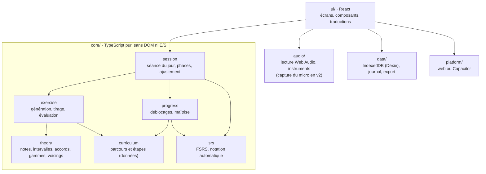

# Oreille musicale — Document de conception

> **Statut** : v0.9 ; version 1.0 de l'appli publiée, v2 en cours
> **Date** : 20 novembre 2026
> **Objet** : application web et Android d'entraînement de l'oreille musicale (intervalles, accords, gammes et modes), avec difficulté progressive, suivi de progression et révisions espacées.
> **Historique** : v0.1, version initiale ; v0.2, ajout des gammes et modes, et des exercices chantés prévus en v2 ; v0.3, premières décisions (public, framework, hébergement, licence) ; v0.4, révisions recalculées depuis le journal (J3) ; v0.5, accords et renversements (J4) ; v0.6, gammes et modes (J5), décisions de #10 ; v0.7, Android et hors-ligne (J6) ; v0.8, finitions et version 1.0 (J7), exercices chantés précisés pour la v2 (notes extraites d'un intervalle ou d'un accord, chant seul, instruments plus tard) ; v0.9, synchronisation chiffrée de bout en bout, sans compte (§10.8).

## Sommaire

1. [Résumé](#1-résumé)
2. [Contexte et objectifs](#2-contexte-et-objectifs)
3. [Utilisateurs visés](#3-utilisateurs-visés)
4. [Principes pédagogiques](#4-principes-pédagogiques)
5. [Périmètre fonctionnel](#5-périmètre-fonctionnel)
6. [Contenu musical](#6-contenu-musical)
7. [Progression](#7-progression)
8. [Révisions et séance du jour](#8-révisions-et-séance-du-jour)
9. [Expérience utilisateur](#9-expérience-utilisateur)
10. [Architecture technique](#10-architecture-technique)
11. [Évolution : exercices chantés (v2)](#11-évolution--exercices-chantés-v2)
12. [Plan de réalisation](#12-plan-de-réalisation)
13. [Risques](#13-risques)
14. [Décisions et questions ouvertes](#14-décisions-et-questions-ouvertes)
15. [Annexes](#15-annexes)

---

## 1. Résumé

*Oreille musicale* est une application d'entraînement auditif pour le web et Android. Elle propose trois familles d'exercices, la **reconnaissance d'intervalles**, **d'accords** et **de gammes et modes**, organisées en **parcours progressifs** : on part de quelques éléments très contrastés, on en ajoute un à la fois, et on passe des présentations les plus faciles (intervalles ascendants, accords arpégés, modes sur bourdon) aux plus difficiles (intervalles harmoniques, accords renversés, mélodies modales).

Chaque élément acquis entre dans un système de **révisions espacées** (algorithme FSRS) qui le refait travailler juste avant qu'il ne soit oublié. Les erreurs alimentent une **matrice de confusion** qui déclenche des exercices ciblés entre éléments souvent confondus. Au quotidien, un seul bouton suffit : la **séance du jour** (≈ 10 min) enchaîne révisions et nouvelles notions.

Une v2 ajoutera des **exercices chantés** : chanter un intervalle, l'arpège d'un accord ou une gamme, avec analyse de la voix au micro (§11).

**Décisions structurantes**

| # | Décision | Raison |
|---|---|---|
| D1 | Une seule base de code **TypeScript + React**, publiée en **PWA** sur le web et empaquetée pour **Android avec Capacitor** | Un seul code à maintenir ; Web Audio couvre le besoin ; accès aux fonctions natives (notifications, micro) |
| D2 | **Local-first**, sans compte en v1 ; un **journal d'événements** est la source de vérité | Hors-ligne, confidentialité, simplicité ; recalculs et synchronisation future facilités |
| D3 | Questions **générées** à la volée (fondamentale, registre, orthographe) et jouées par un **échantillonneur de piano** | Entraîner l'oreille relative plutôt que la mémoire de sons précis |
| D4 | Progression en **grille** (éléments × présentations), chaque étape en 4 phases : découverte → comparaison → entraînement → validation | Difficulté progressive et lisible, sans marche trop haute |
| D5 | Révisions par **compétence** (ex. « tierce mineure descendante ») avec **FSRS** et une **note calculée automatiquement** | Planification éprouvée, adaptée à des questions toujours renouvelées |
| D6 | **Cœur métier en TypeScript pur** (théorie, génération, progression, révisions), testé indépendamment de l'interface et de l'audio | Fiabilité et testabilité |
| D7 | Le **type de réponse** est abstrait dès la v1 : boutons en v1, chant au micro en v2 | Ajouter les exercices chantés sans refonte |

---

## 2. Contexte et objectifs

### 2.1 Contexte

Reconnaître intervalles, accords et gammes à l'oreille sert à jouer d'oreille, relever des morceaux, improviser ou réussir ses examens de formation musicale. Cette compétence se construit par une pratique **courte, régulière et progressive**. L'appli combine trois choses : un parcours guidé, une vraie répétition espacée et un travail ciblé sur ses propres confusions, le tout en français et hors-ligne.

### 2.2 Objectifs

- **O1** — Reconnaître les 12 intervalles simples, ascendants, descendants et harmoniques.
- **O2** — Reconnaître les principaux accords : triades (majeur, mineur, diminué, augmenté, suspendus) et accords de septième (7, 7M, m7, ø, °7, m7M, 7sus4), y compris renversés.
- **O3** — Reconnaître les gammes usuelles (majeure, mineures naturelle, harmonique et mélodique, pentatoniques, blues) et les 7 modes de la gamme majeure.
- **O4** — Rendre la progression **automatique et visible** : l'appli choisit quoi travailler, on voit ce qu'on maîtrise.
- **O5** — **Retenir dans la durée** grâce aux révisions espacées.
- **O6** — Fonctionner **hors-ligne**, en séances de 5 à 15 min, sur téléphone comme sur ordinateur.
- **O7** — Interface et terminologie **françaises** (Do Ré Mi, 3M, 5J, dorien…) ; anglais possible plus tard.

### 2.3 Non-objectifs de la v1

- Exercices chantés (détection de hauteur au micro) : prévus en v2, voir §11.
- Dictée mélodique, rythme.
- Écoute fonctionnelle (degrés, cadences, enchaînements d'accords) : autre piste prioritaire pour la v2.
- Application iOS native (la PWA reste utilisable sur iPhone).
- Comptes, synchronisation, fonctions sociales, monétisation.

### 2.4 Indicateurs de réussite

- Pratique au moins 5 jours par semaine sur la durée.
- Taux de réussite observé en révision proche de la rétention cible (≈ 90 %) : signe que la planification est bien calibrée.
- Nombre de compétences « consolidées » et « maîtrisées » en hausse continue.
- Aucun défaut audio perceptible (clics, décalages, coupures) sur les appareils de test.

---

## 3. Utilisateurs visés

| Profil | Besoins | Conséquences pour l'appli |
|---|---|---|
| **Débuter de zéro** (amateur, autodidacte) | Être guidé, ne pas se décourager, séances courtes | Parcours guidé, chansons repères, feedback pédagogique, séance du jour |
| **Préparer la formation musicale** (école de musique, conservatoire) | Intervalles, accords, renversements et gammes avec le vocabulaire des cours | Terminologie française exacte (4J, 5−, septième de dominante, mineure harmonique…), convention Do3 = do central |
| **Entretenir et approfondir** (jazz, accompagnement, improvisation) | Accords de septième, renversements, modes, entretien des acquis | Tests de positionnement, modes sur bourdon, révisions, entraînement libre paramétrable |

Contexte d'usage principal : une séance quotidienne de 5 à 15 min, souvent sur téléphone avec écouteurs, parfois sur ordinateur au clavier.

---

## 4. Principes pédagogiques

Chaque fonctionnalité doit pouvoir se rattacher à l'un de ces principes.

1. **Du contraste à la nuance.** Commencer par des éléments très différents (tierce majeure, quinte, octave), ajouter un élément à la fois et le confronter d'abord à son voisin le plus proche (4J contre 5J, 3m contre 3M, dorien contre éolien).
2. **Variabilité.** Fondamentale et registre changent à chaque question (puis timbre et tempo) : on apprend à reconnaître une *relation* entre des notes, pas un son précis.
3. **Pratique entrelacée.** Dès qu'un élément est introduit, il est mélangé aux autres : on apprend mieux à discriminer en alternant qu'en répétant un même élément en bloc (Kornell & Bjork, 2008).
4. **Récupération active et feedback contrastif.** Chaque question appelle une réponse (Roediger & Karpicke, 2006) ; après une erreur, on réentend la bonne réponse **et** la sienne, sur la même fondamentale.
5. **Répétition espacée.** Ce qui est acquis revient à intervalles croissants, juste avant l'oubli (Cepeda et al., 2006).
6. **Difficulté désirable.** En apprentissage, viser 80 à 85 % de réussite (Wilson et al., 2019) : au-dessus, on ajoute de la variabilité ; en dessous, on simplifie.
7. **Peu mais souvent.** Des séances courtes et quotidiennes plutôt que longues et rares.
8. **Échafaudages amovibles.** Les aides (chansons repères, réécoute, arpège d'un accord plaqué, bourdon sous un mode) sont là au début puis s'effacent ; leur usage est pris en compte dans l'évaluation.
9. **Entendre, puis produire.** On commence par reconnaître ; chanter ce qu'on reconnaît (v2) relie ensuite l'oreille à la voix et consolide les deux.

---

## 5. Périmètre fonctionnel

### 5.1 Version 1

| Fonction | Description | Priorité |
|---|---|---|
| Intervalles | 12 intervalles simples ; ascendants, descendants, harmoniques | Indispensable |
| Accords | Triades et septièmes ; reconnaissance de la qualité (même renversée) et identification du renversement | Indispensable |
| Gammes et modes | Gammes majeure, mineures, pentatoniques, blues ; 7 modes présentés sur bourdon et reconnus par leur note caractéristique | Indispensable |
| Parcours progressifs | Étapes débloquées en grille, 4 phases par étape (§7) | Indispensable |
| Révisions espacées | FSRS par compétence, notation automatique (§8) | Indispensable |
| Séance du jour | Révisions dues + duels + étape en cours, ≈ 10 min (§8.7) | Indispensable |
| Feedback contrastif | Écoute comparée bonne réponse / réponse donnée, notes affichées sur un mini-clavier | Indispensable |
| Hors-ligne | PWA (web), application installable (Android) | Indispensable |
| Statistiques | Grille de maîtrise, matrice de confusion, historique, série | Important |
| Entraînement libre | Choix des éléments, présentations, registre, tempo, nombre de questions | Important |
| Sauvegarde | Export / import d'un fichier JSON | Important |
| Tests de positionnement | Valider d'emblée les étapes déjà maîtrisées (§7.6) | Important |
| Rappels | Une notification quotidienne (Android) | Souhaitable |
| Chansons repères | Mnémotechniques par intervalle, personnalisables | Souhaitable |
| Timbres supplémentaires | Son pur, puis vibraphone et cordes (v1.0) ; guitare, orgue… ensuite | Souhaitable |
| Dons | Lien discret vers la page Ko-fi du projet (§10.11) | Souhaitable |

### 5.2 Pistes pour la suite

- **Exercices chantés** : chanter un intervalle, l'arpège d'un accord, une gamme ou un mode, avec analyse de la voix (§11).
- Écoute fonctionnelle : degrés dans une tonalité, cadences, enchaînements (II–V–I…).
- Accords enrichis (6, 9, 11, 13, altérations), voicings ouverts et drop 2.
- Intervalles composés (au-delà de l'octave) ; modes des mineures mélodique et harmonique, gammes symétriques (par tons, diminuée), gammes bebop.
- Réponse jouée à l'instrument ou sur un clavier MIDI.
- Synchronisation entre appareils (compte optionnel).
- Dictée mélodique, rythme.
- Interface en anglais.

---

## 6. Contenu musical

> **Convention de ce document** : les registres techniques sont notés en notation scientifique anglo-saxonne (C4 = do central, A4 = 440 Hz). L'interface utilisera par défaut la convention française (Do3 = do central, La3 = 440 Hz).

### 6.1 Intervalles

Les codes servent d'identifiants internes ; l'interface affiche l'abréviation française et le nom complet.

| Code | ½ tons | Nom | Abrév. | Exemple | Repère ascendant\* | Repère descendant\* |
|---|---|---|---|---|---|---|
| `m2` | 1 | Seconde mineure | 2m | Do → Ré♭ | *Les Dents de la mer* | *La Lettre à Élise* |
| `M2` | 2 | Seconde majeure | 2M | Do → Ré | *Frère Jacques* | *Yesterday* |
| `m3` | 3 | Tierce mineure | 3m | Do → Mi♭ | *Smoke on the Water* | *Hey Jude* |
| `M3` | 4 | Tierce majeure | 3M | Do → Mi | *When the Saints* | *5e Symphonie* (Beethoven) |
| `P4` | 5 | Quarte juste | 4J | Do → Fa | *La Marseillaise* | *Une petite musique de nuit* |
| `TT` | 6 | Triton (quarte augmentée / quinte diminuée) | 4+ / 5− | Do → Fa♯ | *Les Simpson* | — |
| `P5` | 7 | Quinte juste | 5J | Do → Sol | *Ah ! vous dirai-je, maman* | *Les Pierrafeu* |
| `m6` | 8 | Sixte mineure | 6m | Do → La♭ | — | — |
| `M6` | 9 | Sixte majeure | 6M | Do → La | *My Bonnie* | — |
| `m7` | 10 | Septième mineure | 7m | Do → Si♭ | *Star Trek* (série originale) | — |
| `M7` | 11 | Septième majeure | 7M | Do → Si | — | — |
| `P8` | 12 | Octave juste | 8J | Do → Do | *Over the Rainbow* | — |

\* Repères retenus dans l'appli : ceux de ce tableau, avec *Greensleeves* pour la 3m montante, *The Entertainer* (après les notes d'appel) pour la 6m montante, *Nobody Knows the Trouble I've Seen* pour la 6M descendante et *Take On Me* (refrain) pour la 7M montante. À confirmer à l'oreille. L'utilisateur peut saisir ses propres repères (écran « Mes chansons repères ») : les plus efficaces sont des airs qu'on connaît bien.

### 6.2 Accords

**Triades**

| Code | Nom | Symboles | ½ tons | Sur Do |
|---|---|---|---|---|
| `maj` | Accord parfait majeur | Do · C | 0-4-7 | Do Mi Sol |
| `min` | Accord parfait mineur | Dom · Cm | 0-3-7 | Do Mi♭ Sol |
| `dim` | Accord de quinte diminuée | Do° · Cdim | 0-3-6 | Do Mi♭ Sol♭ |
| `aug` | Accord de quinte augmentée | Do+ · Caug | 0-4-8 | Do Mi Sol♯ |
| `sus4` | Accord suspendu (quarte) | Dosus4 · Csus4 | 0-5-7 | Do Fa Sol |
| `sus2` | Accord suspendu (seconde) | Dosus2 · Csus2 | 0-2-7 | Do Ré Sol |

**Accords de septième**

| Code | Nom | Symboles | ½ tons | Sur Do |
|---|---|---|---|---|
| `dom7` | Septième de dominante | Do7 · C7 | 0-4-7-10 | Do Mi Sol Si♭ |
| `maj7` | Septième majeure | Do7M · Cmaj7 | 0-4-7-11 | Do Mi Sol Si |
| `m7` | Mineur septième | Dom7 · Cm7 | 0-3-7-10 | Do Mi♭ Sol Si♭ |
| `m7b5` | Demi-diminué (septième de sensible) | Doø · Cm7♭5 | 0-3-6-10 | Do Mi♭ Sol♭ Si♭ |
| `dim7` | Septième diminuée | Do°7 · Cdim7 | 0-3-6-9 | Do Mi♭ Sol♭ Si♭♭ |
| `mmaj7` | Mineur septième majeure | Dom7M · Cm(maj7) | 0-3-7-11 | Do Mi♭ Sol Si |
| `7sus4` | Septième suspendue | Do7sus4 · C7sus4 | 0-5-7-10 | Do Fa Sol Si♭ |

**Renversements** : état fondamental (basse = fondamentale), 1er renversement (basse = tierce), 2e (basse = quinte), 3e pour les septièmes (basse = septième). Deux types d'exercices :

- reconnaître la **qualité** d'un accord quel que soit son renversement ;
- identifier le **renversement** lui-même.

Les accords **symétriques** (augmenté, septième diminuée) et **suspendus** sont exclus de l'identification du renversement, et les suspendus de la reconnaissance de qualité en renversement : leurs renversements sont indiscernables, à l'oreille, d'autres accords à l'état fondamental (Dosus4 renversé donne Fa–Sol–Do, c'est-à-dire Fasus2).

### 6.3 Gammes et modes

**Gammes**

| Code | Nom | ½ tons | Sur Do | Remarque |
|---|---|---|---|---|
| `major` | Majeure | 0-2-4-5-7-9-11 | Do Ré Mi Fa Sol La Si | |
| `natmin` | Mineure naturelle (ancienne) | 0-2-3-5-7-8-10 | Do Ré Mi♭ Fa Sol La♭ Si♭ | |
| `harmin` | Mineure harmonique | 0-2-3-5-7-8-11 | Do Ré Mi♭ Fa Sol La♭ Si | Seconde augmentée entre les 6e et 7e degrés |
| `melmin` | Mineure mélodique | 0-2-3-5-7-9-11 en montant | Do Ré Mi♭ Fa Sol La Si | Forme classique : redescend en mineure naturelle |
| `pentmaj` | Pentatonique majeure | 0-2-4-7-9 | Do Ré Mi Sol La | |
| `pentmin` | Pentatonique mineure | 0-3-5-7-10 | Do Mi♭ Fa Sol Si♭ | |
| `blues` | Blues | 0-3-5-6-7-10 | Do Mi♭ Fa Sol♭ Sol Si♭ | Pentatonique mineure + quinte diminuée (*blue note*) |

Le nombre de notes varie de 5 à 7 : c'est un indice légitime, qui fait partie de la reconnaissance.

**Modes de la gamme majeure**, du plus lumineux au plus sombre. Chaque mode ne diffère du suivant que par une note abaissée ; c'est aussi l'ordre des boutons de réponse.

| Code | Mode | Famille | ½ tons | Note caractéristique | Sur Do |
|---|---|---|---|---|---|
| `lydian` | Lydien | majeure | 0-2-4-6-7-9-11 | 4+ | Do Ré Mi Fa♯ Sol La Si |
| `ionian` | Ionien | majeure | 0-2-4-5-7-9-11 | — (référence majeure) | Do Ré Mi Fa Sol La Si |
| `mixolydian` | Mixolydien | majeure | 0-2-4-5-7-9-10 | 7m | Do Ré Mi Fa Sol La Si♭ |
| `dorian` | Dorien | mineure | 0-2-3-5-7-9-10 | 6M | Do Ré Mi♭ Fa Sol La Si♭ |
| `aeolian` | Éolien | mineure | 0-2-3-5-7-8-10 | — (référence mineure) | Do Ré Mi♭ Fa Sol La♭ Si♭ |
| `phrygian` | Phrygien | mineure | 0-1-3-5-7-8-10 | 2m | Do Ré♭ Mi♭ Fa Sol La♭ Si♭ |
| `locrian` | Locrien | diminuée | 0-1-3-5-6-8-10 | 2m et 5− | Do Ré♭ Mi♭ Fa Sol♭ La♭ Si♭ |

Principes propres aux modes :

- **Un mode n'existe que par rapport à sa tonique.** Joué sans repère, un ré dorien s'entend facilement comme un do majeur commencé sur ré. Les modes sont donc d'abord présentés **sur un bourdon** : la tonique tenue, doublée à l'octave, sans tierce ni quinte pour ne rien révéler (le locrien n'a pas de quinte juste).
- **Approche par note caractéristique** : on reconnaît d'abord la famille (tierce majeure ou mineure), puis la note qui distingue le mode de l'ionien ou de l'éolien. Le feedback met cette note en évidence, et l'écoute comparée oppose le mode à sa référence sur la même tonique.
- L'ionien et l'éolien sont la gamme majeure et la mineure naturelle, présentées ici sur bourdon et sous leur nom modal (« Ionien (majeur) »).

Plus tard : modes des mineures mélodique (lydien ♭7, altéré…) et harmonique (phrygien dominant…), gammes symétriques (par tons, diminuée), gammes bebop.

### 6.4 Présentations

La **présentation** est la façon de faire entendre un élément.

| Famille | Présentations, de la plus facile à la plus difficile |
|---|---|
| Intervalles | mélodique ascendant (`asc`) → mélodique descendant (`desc`) → harmonique, notes simultanées (`harm`) |
| Accords | arpégé montant (`arp`) → plaqué à l'état fondamental (`block`) → plaqué renversé (`inv`) → voicings ouverts (expert, v2) |
| Gammes | montante puis descendante (`updown`) → montante seule (`asc`) → descendante seule (`desc`) |
| Modes | gamme sur bourdon (`drone`) → gamme sans bourdon (`plain`) → mélodie dans le mode, sur bourdon (`melody`) |

En v2, une présentation chantée (`sing`) s'ajoutera aux familles qui s'y prêtent (§11).

### 6.5 Génération d'une question

Une question est produite à partir d'une **compétence** (ex. `int:m3:asc`) et des **paramètres de l'étape**. Sa version concrète s'appelle une **réalisation**.

1. **Fondamentale** (ou tonique) tirée au hasard dans le registre autorisé, différente de celle de la question précédente : F3–F5 au début pour les intervalles, élargi jusqu'à C3–C6 ; tonique entre C3 et C4 pour les gammes.
2. **Registre grave** : jamais d'intervalle d'une tierce ou moins entre deux voix sous C3 (le son devient confus) ; basse des accords en position serrée entre C3 et C4.
3. **Orthographe** : notes écrites de façon à limiter les altérations, sans double altération sauf dans la septième diminuée et la sensible de certaines tonalités mineures. Une 3m sur Do s'affiche Do → Mi♭, jamais Do → Ré♯. Les gammes heptatoniques s'écrivent avec une lettre par degré.
4. **Voicing** : position serrée ; les renversements sont obtenus par rotation, la basse étant tirée dans le registre autorisé.
5. **Durées** (tempo normal) : note mélodique 0,9 s + 0,1 s de silence ; intervalle harmonique 1,8 s ; accord plaqué 2 s ; arpège 0,45 s entre les notes, notes tenues jusqu'à la fin ; gamme 0,3 s par note, dernière note tenue 1 s. Tempo lent ×1,4, rapide ×0,7.
6. **Bourdon** : la tonique doublée à l'octave, sous la gamme ou la mélodie, jouée par un son synthétique tenu (le piano s'éteint trop vite) et nettement plus doux ; il commence une seconde avant la première note.
7. **Mélodie modale** : 8 à 12 notes, qui commencent et finissent sur la tonique, surtout par degrés conjoints (sauts limités à la quinte), avec au moins deux fois la note caractéristique, sur un rythme simple.
8. **Nuance** constante (vélocité moyenne) ; légère variation aléatoire au chapitre Expert.

Le hasard passe par un **générateur pseudo-aléatoire initialisable** (graine), injecté : les tests sont reproductibles et les bugs rejouables.

---

## 7. Progression

### 7.1 Vocabulaire

- **Élément** : ce qu'on reconnaît (tierce mineure, accord m7, mode dorien…).
- **Présentation** : la façon de le faire entendre (ascendant, harmonique, plaqué, sur bourdon…).
- **Compétence** : un élément dans une présentation, ex. « tierce mineure ascendante » (`int:m3:asc`). C'est l'unité de suivi et de révision.
- **Étape** : une leçon qui introduit en général **un** nouvel élément dans une présentation, au milieu d'un ensemble de réponses possibles.
- **Parcours** : une grille d'étapes (Intervalles, Triades, Septièmes, Renversements, Gammes, Modes).

### 7.2 Grilles de progression

En colonnes, l'ensemble des réponses s'agrandit d'un élément à la fois ; en lignes, les présentations vont de la plus facile à la plus difficile. **Une étape se débloque quand l'étape à sa gauche et l'étape au-dessus sont validées.** On progresse ainsi sur plusieurs fronts à la fois, sans jamais sauter de marche.

```
              1        2        3        4        5
              3M·5J·8J +4J      +3m      +2M      +2m      …
Ascendant     [x] ──── [x] ──── [x] ──── [>] ──── [ ]      …
               │        │        │        │        │
Descendant    [x] ──── [x] ──── [>] ──── [ ] ──── [ ]      …
               │        │        │        │        │
Harmonique    [x] ──── [>] ──── [ ] ──── [ ] ──── [ ]      …

[x] validée    [>] disponible    [ ] verrouillée
```

**Vue d'ensemble**

| Parcours | Lignes (présentations) | Colonnes | Étapes | Débloqué par |
|---|---|---|---|---|
| Intervalles | `asc`, `desc`, `harm` | 10 | 30 | — (dès le départ) |
| Triades | `arp`, `block`, `inv` | 5 | 13 | — (dès le départ) |
| Septièmes | `arp`, `block`, `inv` | 6 | 17 | Triades `block`, colonne 2 |
| Renversements | suite linéaire | — | 6 | Triades `block`, colonne 1 |
| Gammes | `updown`, `asc`, `desc` | 6 | 17 | Intervalles `asc`, colonne 3 (tierces connues) |
| Modes | `drone`, `plain`, `melody` | 6 | 18 | Gammes `updown`, colonne 2 |
| **Total** | | | **101** | |

**Parcours Intervalles**

| Col. | Ajout | Réponses possibles | Comparé à |
|---|---|---|---|
| 1 | 3M, 5J, 8J | 3 | — |
| 2 | 4J | 4 | 5J, 3M |
| 3 | 3m | 5 | 3M |
| 4 | 2M | 6 | 3m |
| 5 | 2m | 7 | 2M |
| 6 | 6M | 8 | 5J |
| 7 | 6m | 9 | 6M, 5J |
| 8 | 7m | 10 | 6M, 8J |
| 9 | 7M | 11 | 8J, 7m |
| 10 | triton | 12 | 4J, 5J |

Une fois la grille terminée s'ouvre un chapitre **Expert** : directions mélangées, registre large, tempo rapide, timbres variés ; puis les intervalles composés en v2.

**Parcours Triades**

| Col. | Ajout | Comparé à | Remarque |
|---|---|---|---|
| 1 | majeur, mineur | — | |
| 2 | diminué | mineur | |
| 3 | augmenté | majeur | |
| 4 | sus4 | majeur | lignes `arp` et `block` seulement |
| 5 | sus2 | sus4 | lignes `arp` et `block` seulement |

**Parcours Septièmes**

| Col. | Ajout | Comparé à | Remarque |
|---|---|---|---|
| 1 | 7, 7M | — | |
| 2 | m7 | 7 | |
| 3 | ø (m7♭5) | m7 | |
| 4 | °7 | ø | |
| 5 | m7M | m7 | |
| 6 | 7sus4 | 7 | lignes `arp` et `block` seulement |

**Parcours Renversements** (accords plaqués ; on répond par le renversement)

| Étape | Accords | Réponses | Débloquée par |
|---|---|---|---|
| R1 | majeur | fondamental, 1er | Triades `block` col. 1 |
| R2 | majeur | + 2e | R1 |
| R3 | mineur | fondamental, 1er, 2e | R2 |
| R4 | majeur et mineur mêlés | fondamental, 1er, 2e | R3 |
| R5 | septième de dominante | fondamental, 1er, 2e, 3e | R4 + Septièmes `block` col. 1 |
| R6 | 7, 7M, m7 mêlés | fondamental, 1er, 2e, 3e | R5 + Septièmes `block` col. 2 |

**Parcours Gammes**

| Col. | Ajout | Comparé à | Remarque |
|---|---|---|---|
| 1 | majeure, mineure naturelle | — | |
| 2 | mineure harmonique | mineure naturelle | |
| 3 | pentatonique majeure | majeure | |
| 4 | pentatonique mineure | mineure naturelle | |
| 5 | blues | pentatonique mineure | |
| 6 | mineure mélodique | mineure harmonique, majeure | lignes `updown` et `asc` seulement : sa descente classique se confond avec la mineure naturelle |

**Parcours Modes**

| Col. | Ajout | Comparé à | Note caractéristique |
|---|---|---|---|
| 1 | ionien, éolien | — | (références majeure et mineure) |
| 2 | mixolydien | ionien | 7m |
| 3 | dorien | éolien | 6M |
| 4 | lydien | ionien | 4+ |
| 5 | phrygien | éolien | 2m |
| 6 | locrien | phrygien | 5− |

L'ordre suit la fréquence d'usage : mixolydien et dorien (rock, folk, jazz) d'abord, locrien en dernier.

Le curriculum est une **donnée versionnée** (un fichier TypeScript), pas de la logique : on peut réordonner ou ajouter des étapes sans toucher au code.

```ts
// Intervalles ascendants, colonne 2. Les prérequis se déduisent de la position dans la grille.
const step: StepDef = {
  id: 'int.asc.02',
  track: 'intervals',
  presentation: 'asc',
  answers: ['M3', 'P4', 'P5', 'P8'],
  newItems: ['P4'],
  contrast: { P4: ['P5', 'M3'] },
  generation: { range: ['F3', 'F5'], instrument: 'piano', tempo: 'normal' },
  validation: { minAccuracy: 0.9, minNewItemAccuracy: 0.75 },
};
```

### 7.3 Déroulé d'une étape

| Phase | Contenu | Passage à la suite |
|---|---|---|
| 1 · Découverte | Le nouvel élément est joué 4 fois sur des fondamentales différentes, avec son nom (et sa chanson repère ou sa note caractéristique), puis alterné avec son voisin. Non noté. | Quand l'utilisateur le souhaite (phase facultative) |
| 2 · Comparaison | Le nouvel élément contre son ou ses voisins (2 ou 3 réponses), ≈ 50 % des questions sur le nouvel élément. | 8 bonnes réponses sur les 10 dernières, ou 20 questions au plus |
| 3 · Entraînement | Tout l'ensemble de l'étape ; ≈ 40 % des questions sur le nouvel élément ; feedback complet ; difficulté ajustée (§7.5). | Dès 85 % de réussite sur les 20 dernières questions et 5 passages du nouvel élément, le test est proposé |
| 4 · Validation | Test de 4 questions par réponse possible (entre 12 et 30), dont ≈ 30 % sur le nouvel élément ; feedback bref. | Réussi avec au moins 90 % au total et 75 % sur le nouvel élément |

- Une étape peut s'étaler sur plusieurs séances : la phase en cours est sauvegardée. Un test interrompu recommence du début.
- **« Je connais déjà »** : le test est accessible à tout moment, pour avancer vite.
- En cas d'échec, retour à l'entraînement avec les éléments ratés surpondérés.
- En colonne 1, tous les éléments sont nouveaux (pas de comparaison) ; une étape sans nouvel élément (R4) se limite à l'entraînement et au test.
- À la validation, les nouvelles compétences entrent dans les révisions (§8.2).

### 7.4 Niveaux de maîtrise

| Niveau | Condition |
|---|---|
| 0 · Non vue | Pas encore introduite |
| 1 · En apprentissage | Introduite dans une étape non validée |
| 2 · Acquise | Étape validée ; stabilité FSRS inférieure à 7 jours |
| 3 · Consolidée | Stabilité de 7 à 30 jours |
| 4 · Maîtrisée | Stabilité d'au moins 30 jours |
| Marque « fragile » | Dernière révision ratée, ou moins de 70 % sur les 10 dernières réponses |

La **stabilité** (au sens de FSRS) est le nombre de jours au bout duquel la probabilité de se souvenir tombe à 90 %.

### 7.5 Ajustement de la difficulté en entraînement

- Selon le taux de réussite sur les 10 dernières questions :
  - **moins de 65 %** : on simplifie temporairement (tempo lent, registre resserré, duel sur la confusion la plus fréquente) ;
  - **de 65 à 90 %** : zone cible, rien ne change ;
  - **plus de 90 %** : on ajoute de la variabilité (registre élargi, tempo plus rapide, puis timbres variés quand ils existeront).
- **Tirage pondéré** : poids d'un élément = 1 + 2 × taux d'erreur récent (lissé) + bonus « nouvel élément » + bonus « pas entendu depuis longtemps ». Jamais plus de 3 fois la même réponse d'affilée.
- Les **réponses proposées** sont toujours l'ensemble complet de l'étape (pas de QCM réduit à 4 choix) : la discrimination reste réelle.

### 7.6 Tests de positionnement

Chaque parcours a son test, proposé au premier lancement (« J'ai déjà des bases ») puis accessible depuis l'écran du parcours. Il avance par paliers (pour les intervalles : colonnes 1, 4, 7 et 10, ligne par ligne), à raison de 6 questions par palier, et s'arrête au premier palier sous 5/6. Les étapes jusqu'au dernier palier réussi sont validées et leurs compétences entrent en révision. Durée : 10 min au plus par parcours.

---

## 8. Révisions et séance du jour

### 8.1 Principe

- L'unité de révision est la **compétence** (ex. `int:m6:desc`), pas une question figée : chaque révision génère de nouvelles réalisations.
- Algorithme : **FSRS** via la bibliothèque `ts-fsrs`, rétention cible **90 %**, paramètres par défaut, puis optimisés sur l'historique de l'utilisateur quand il sera suffisant (v2).
- FSRS ne planifie qu'**entre les jours** ; la répétition au sein d'une journée est assurée par les étapes et les séances.
- Le « jour » commence à 4 h du matin (heure locale), pour qu'une séance tardive compte pour la veille.

### 8.2 Entrée en révision

À la validation d'une étape, chaque nouvelle compétence reçoit une première note FSRS : *Bien* si elle a obtenu au moins 90 % pendant le test, *Difficile* sinon. Sa première révision tombe alors un à trois jours plus tard.

### 8.3 Note automatique

FSRS attend une note parmi *À revoir*, *Difficile*, *Bien* et *Facile*. En révision, chaque compétence due est posée **3 fois** (réalisations différentes, mélangées avec d'autres questions) ; la note se calcule ainsi :

| Résultat des 3 questions | Note |
|---|---|
| 0 ou 1 bonne réponse | À revoir (*Again*) |
| 2 bonnes réponses | Difficile (*Hard*) |
| 3 bonnes, mais lentes (temps médian > 1,5 × référence) ou avec aides | Difficile (*Hard*) |
| 3 bonnes, temps normal | Bien (*Good*) |
| 3 bonnes, rapides (temps médian < 0,6 × référence) et sans aide | Facile (*Easy*) |

- **Temps de réponse** : de la fin de la première écoute jusqu'à la réponse, corrigé de la latence de sortie audio quand le navigateur la fournit (utile avec des écouteurs Bluetooth).
- **Référence** : temps médian personnel des bonnes réponses dans le même contexte (au départ : 3 s pour les intervalles, 4 s pour les accords et les gammes).
- **Aides** : plus d'une réécoute, « écouter arpégé ».

### 8.4 Séance de révision

1. **Sélection** des compétences dues, les plus en retard d'abord, **8 au maximum** par séance (réglable). Après une longue absence, le retard est étalé sur plusieurs jours, en commençant par les compétences fragiles.
2. **Regroupement par contexte de réponse** (famille + présentation, ex. « intervalles descendants », « modes sur bourdon »), car les boutons de réponse doivent être homogènes.
3. **Mélange** : les 3 questions de chaque compétence due sont entrelacées avec ≈ 30 % de questions « distractrices » portant sur les autres compétences acquises du même contexte ; sans elles, la réponse serait devinable.
4. **Réponses proposées** : toutes les compétences acquises du contexte.
5. **Fin de séance** : chaque compétence due reçoit sa note FSRS et donc sa nouvelle échéance. Une note *À revoir* rend la compétence fragile et programme un duel ciblé.

Durée typique : 8 compétences × 3 questions + distracteurs, soit ≈ 35 questions et 5 min (davantage si beaucoup de gammes, plus longues à écouter).

### 8.5 Révisions implicites

Une compétence **due** pratiquée au moins 3 fois le même jour dans une autre activité (étape, entraînement libre) est considérée comme révisée, avec la même règle de notation : pas de travail en double. La pratique d'une compétence non due ne modifie pas son planning, pour ne pas fausser FSRS, mais elle alimente les statistiques et la matrice de confusion.

### 8.6 Matrice de confusion et duels

- Pour chaque contexte de réponse, on compte les couples (élément joué → élément répondu) sur les 60 derniers jours.
- Un couple devient une **confusion active** s'il totalise au moins 3 erreurs et 20 % des réponses à cet élément sur ses 20 dernières apparitions.
- Une confusion active déclenche un **duel** (deux réponses, 10 questions, écoute comparée systématique) dans la prochaine séance du jour, et renforce la paire dans les tirages.
- Les statistiques affichent la matrice en carte de chaleur et les trois confusions principales (« Tu confonds souvent 6M et 7m »).

### 8.7 Séance du jour

Elle est composée automatiquement pour durer le temps de l'objectif quotidien (10 min par défaut) :

1. **révisions** dues (§8.4) ;
2. **duels** en attente (deux au maximum) ;
3. une étape d'un **parcours actif** (l'utilisateur en choisit un ou plusieurs ; par défaut Intervalles et Triades), en alternant d'un jour à l'autre : la première étape disponible, lignes du haut d'abord, reprise à sa phase ;
4. s'il reste du temps, une étape d'un autre parcours actif.

La séance s'arrête proprement à la fin d'un bloc quand l'objectif est atteint ; on peut toujours continuer.

---

## 9. Expérience utilisateur

### 9.1 Écrans

| Écran | Contenu |
|---|---|
| Accueil | Bouton « Séance du jour » avec son contenu (ex. « 6 révisions · Intervalles descendants : + 2m ») ; série, objectif du jour ; accès aux parcours, à l'entraînement libre et aux statistiques |
| Parcours | Les grilles (§7.2) avec l'état de chaque étape, la progression globale et le choix des parcours actifs |
| Étape | Phase en cours, accès direct au test (« Je connais déjà ») |
| Exercice | Écran de question commun à tous les exercices (§9.2) |
| Bilan | Score, compétences en progrès, confusions repérées, prochaines révisions |
| Entraînement libre | Famille, éléments, présentations, registre, tempo, timbre, nombre de questions ; préréglages enregistrables |
| Statistiques | Grille de maîtrise, matrice de confusion, courbes de réussite et de temps par compétence, calendrier d'activité |
| Réglages | Notation, convention d'octave, timbre, tempo, volume, passage automatique, objectif, rappel, chansons repères, thème, export/import, réinitialisation, crédits |
| Premier lancement | Présentation, test audio, préférences, niveau (§9.3) |

### 9.2 Écran d'exercice

```
┌────────────────────────────────────────┐
│ ←  Intervalles ascendants · étape 4    │
│ ██████████████░░░░░░░░░░      11 / 20  │
│                                        │
│             [ Réécouter ]              │
│                                        │
│      [ 2M ]     [ 3m ]     [ 3M ]      │
│      [ 4J ]     [ 5J ]     [ 8J ]      │
│                                        │
└────────────────────────────────────────┘

Après une erreur :
┌────────────────────────────────────────┐
│ Non : c'était une tierce majeure (3M)  │
│ Ta réponse : quarte juste (4J)         │
│                                        │
│ Ré → Fa♯                [mini-clavier] │
│                                        │
│ [ Écouter 3M ]    [ Écouter 4J ]       │
│                         [ Suivant → ]  │
└────────────────────────────────────────┘
```

- Le son part dès l'affichage de la question (les navigateurs exigent un premier geste de l'utilisateur : il a lieu au démarrage de la séance).
- Boutons dans un **ordre fixe** (par taille d'intervalle, par famille d'accords, du mode le plus lumineux au plus sombre) pour créer des automatismes ; abréviation, et nom complet si la place le permet.
- **Bonne réponse** : confirmation brève, passage automatique à la question suivante (désactivable).
- **Erreur** : panneau de correction avec les notes jouées (nommées et sur un mini-clavier) et l'**écoute comparée** des deux réponses sur la même fondamentale. Pour une gamme ou un mode, le mini-clavier met en évidence la note qui fait la différence (ex. le Si♮ du ré dorien face au Si♭ du ré éolien).
- Le feedback ne repose jamais sur la couleur seule (icône + texte).
- **Aides** (prises en compte dans la note) : réécouter ; « écouter arpégé » pour un accord plaqué.
- **Clavier** (web) : Espace pour réécouter, rangée des chiffres pour répondre, Entrée pour continuer. Les touches sont lues par position physique (`KeyboardEvent.code`) pour fonctionner en AZERTY sans Maj.
- **Android** : retour haptique léger en cas d'erreur (désactivable).

### 9.3 Premier lancement

1. Présentation en deux écrans : écouter, répondre, revenir chaque jour.
2. **Test audio** : un son de piano, réglage du volume, conseil d'utiliser des écouteurs.
3. **Préférences** : Do Ré Mi ou C D E ; Do3 ou C4 comme do central.
4. **Niveau** : « Je débute » (étape 1) ou « J'ai déjà des bases » (tests de positionnement).
5. **Objectif quotidien** (5, 10 ou 15 min) et rappel (Android).

### 9.4 Motivation

- Un seul bouton pour la séance du jour : l'appli décide quoi travailler.
- Objectif quotidien en minutes de pratique active (une pause de plus d'une minute ne compte pas), affiché sous forme d'anneau.
- **Série** de jours avec objectif atteint ; **un jour de repos par semaine** ne la casse pas : on encourage la régularité sans culpabiliser.
- Les grilles se colorent au fil des progrès.
- Pas de vies, pas de publicité, un rappel au plus par jour.

### 9.5 Terminologie et notation

- Notes : Do Ré Mi (par défaut) ou C D E.
- Octaves : convention française (Do3 = do central, La3 = 440 Hz ; par défaut) ou scientifique (C4 = do central).
- Intervalles : 2m, 2M, 3m, 3M, 4J, 4+/5−, 5J, 6m, 6M, 7m, 7M, 8J ; nom complet dans le feedback et pour les lecteurs d'écran.
- Accords : nom français et symbole (Do7M, Doø, Dom7…), notation anglo-saxonne en option (Cmaj7, Cm7♭5…).
- Gammes : majeure, mineure naturelle (ancienne), harmonique, mélodique, pentatoniques, blues ; modes : ionien, dorien, phrygien, lydien, mixolydien, éolien, locrien.
- Ton : tutoiement, bienveillant, phrases courtes.

### 9.6 Accessibilité

- Contrastes WCAG AA, taille de texte réglable, thème clair, sombre ou système.
- Navigation complète au clavier et au lecteur d'écran (libellés complets, feedback annoncé via une région ARIA).
- Respect de `prefers-reduced-motion` ; cibles tactiles d'au moins 48 dp.

---

## 10. Architecture technique

### 10.1 Choix de la plateforme

| Option | Atouts | Limites |
|---|---|---|
| **A. Web TypeScript + PWA + Capacitor (Android)** — retenue | Une base de code ; Web Audio précis et mature ; itérations rapides ; plugins natifs (notifications, haptique) ; échantillons embarqués dans l'APK | Interface moins « native » ; WebView à valider sur les appareils modestes |
| B. Flutter (web + Android) | Interface native, performances | Lecture polyphonique d'échantillons moins simple, surtout sur le web ; bundle web lourd |
| C. React Native + Expo (+ react-native-web) | Interface native sur Android | Audio à traiter séparément côté natif et côté web, ou via des bibliothèques encore jeunes |
| D. PWA seule (+ TWA pour le Play Store) | Le plus simple | Pas de notifications locales planifiées (il faudrait un serveur de push) ; dépend du navigateur installé |

**Choix : A.** Le besoin audio (jouer quelques notes à la demande, sans réagir en temps réel à un instrument) est entièrement couvert par Web Audio, y compris dans la WebView Android ; la latence de sortie n'y est pas critique. Pour les exercices chantés de la v2, l'analyse du micro se fait aussi en Web Audio (§11.6).

### 10.2 Pile technique

| Domaine | Choix | Remarques |
|---|---|---|
| Langage | TypeScript (strict) | |
| Interface | React + Vite | Choix confirmé |
| Style | Tailwind CSS | |
| Navigation | React Router | |
| État | Zustand pour la séance en cours ; Dexie + `useLiveQuery` pour les données persistées | |
| Théorie musicale | `tonal`, encapsulé dans `core/theory` | Notes, intervalles, accords, gammes, modes, orthographe |
| Révisions | `ts-fsrs`, encapsulé dans `core/srs` | |
| Audio | Web Audio API, échantillonneur maison | Tone.js en plan B |
| Stockage | IndexedDB via Dexie | |
| Hors-ligne | `vite-plugin-pwa` (Workbox) | |
| Android | Capacitor + plugins Local Notifications, Haptics, App | |
| Traductions | i18next | Français d'abord |
| Tests | Vitest, fast-check, Testing Library, Playwright | |
| Qualité | ESLint, Prettier, GitHub Actions | |
| Hébergement web | GitHub Pages, déployé par GitHub Actions | Dépôt public requis avec un compte GitHub gratuit |

Les versions seront figées à l'initialisation du projet.

### 10.3 Architecture en couches



- `core` n'importe ni `ui`, ni `audio`, ni `data`, ni `platform` (règle vérifiée par ESLint).
- Le temps (`now`) et le hasard (`rng`) sont **injectés** : tout le cœur est déterministe et testable.
- `core` expose des fonctions pures du type `(état, événement) → nouvel état` ; `data` enregistre les événements et les projections.

### 10.4 Moteur audio

```ts
interface AudioEngine {
  unlock(): Promise<void>;                   // reprend l'AudioContext après un geste
  load(instrument: InstrumentId, onProgress?: (ratio: number) => void): Promise<void>;
  play(notes: NoteEvent[]): PlaybackHandle;  // planifie une réalisation complète
  stopAll(): void;
}

interface NoteEvent {
  midi: number;               // hauteur
  start: number;              // secondes, relatif au début de la réalisation
  duration: number;           // secondes
  velocity: number;           // 0..1
  instrument?: InstrumentId;  // par défaut celui de la séance ; 'drone' pour le bourdon
}
```

- Le cœur produit des `NoteEvent` ; le moteur se contente de les jouer. La logique musicale se teste donc sans audio.
- **Échantillonneur** : un échantillon tous les 3 demi-tons ; les autres notes sont obtenues en variant la vitesse de lecture (`playbackRate = 2^(écart/12)`, un demi-ton d'écart au plus). Échantillons normalisés en volume ; enveloppe (attaque ≈ 5 ms, relâchement ≈ 250 ms) contre les clics ; compresseur-limiteur en sortie pour les accords.
- **Piano** : échantillons *Salamander Grand Piano* (licence CC BY 3.0), une ou deux couches de vélocité, de A1 à C7, en MP3 (décodable partout, Safari compris) : 1 à 2 Mo.
- **Vibraphone** (mailloches douces, *Versilian Community Sample Library*) et **cordes** (pupitres de violoncelles puis d'altos, notes tenues, *VS Chamber Orchestra 2: Community Edition*) : domaine public (CC0), un échantillon toutes les tierces environ (transposition de 2 demi-tons au plus dans la tessiture), sonie égalisée sur celle du piano, en MP3 : 0,3 et 1 Mo.
- **Son pur** (oscillateur avec enveloppe) : aucun téléchargement, sert de repli.
- **Bourdon** : instrument synthétique tenu (oscillateurs et filtre passe-bas, attaque et relâchement lents), sans téléchargement.
- **Planification** : tous les événements d'une réalisation sont programmés d'un coup sur l'horloge audio ; une nouvelle lecture coupe la précédente par un fondu court.
- **Chargement** paresseux par instrument, avec indicateur de progression ; tampons décodés gardés en mémoire.
- **Cycle de vie** : son coupé quand l'appli passe en arrière-plan, `AudioContext` repris au retour.
- **Android** : `setVolumeControlStream(AudioManager.STREAM_MUSIC)` dans `MainActivity`, pour que les touches de volume règlent le volume média.

### 10.5 Modèle de données

Un **journal d'événements en ajout seul** est la source de vérité ; les états (cartes FSRS, maîtrise, déblocages, matrice de confusion) sont des **projections** recalculables. On peut ainsi corriger une règle de notation et tout recalculer, migrer sans perte, et préparer la synchronisation par simple fusion de journaux.

```ts
type CompetenceId = string; // 'int:m3:asc', 'chd:m7b5:block', 'inv:maj.1:block', 'scl:harmin:updown', 'mod:dorian:drone'
type StepId = string;       // 'int.asc.04', 'tri.block.02', 'sev.inv.03', 'inv.block.02' (R2), 'scl.asc.03', 'mod.drone.02'

// ——— Journal (source de vérité) ———

interface SessionRecord {
  id: string;
  kind: 'daily' | 'custom';
  startedAt: number;             // horodatage (ms)
  endedAt?: number;
  appVersion: string;
  curriculumVersion: string;
}

interface Attempt {
  id: string;
  sessionId: string;
  at: number;
  activity: 'contrast' | 'train' | 'test' | 'review' | 'duel' | 'free' | 'placement';
  stepId?: StepId;
  competenceId: CompetenceId;    // ce qui a été joué
  rendition: {
    midi: number[];
    spelling: string[];          // ex. ['D4', 'F#4']
    presentation: Presentation;  // 'asc', 'block', 'drone'…
    instrument: InstrumentId;
    tempo: Tempo;
  };
  choices?: string[];            // réponses proposées (réponse par boutons)
  answer:
    | { type: 'choice'; value: string }       // v1 : bouton choisi
    | { type: 'sung'; notes: SungNote[] };    // v2 : notes chantées détectées (§11)
  correct: boolean;
  responseTimeMs: number;
  replays: number;
  helpUsed: boolean;             // ex. « écouter arpégé »
}

interface ProgressEvent {
  id: string;
  at: number;
  type: 'step_validated' | 'placement_passed' | 'competence_reset';
  stepId?: StepId;
  competenceIds?: CompetenceId[];
  score?: number;
}

// Non stocké en v1 : les révisions se recalculent en rejouant validations et
// réponses (voir la décision « Révisions recalculées », §14.1).
interface ReviewLog {
  id: string;
  at: number;
  competenceId: CompetenceId;
  grade: 1 | 2 | 3 | 4;          // À revoir | Difficile | Bien | Facile
  source: 'review' | 'implicit' | 'validation' | 'placement';
  attemptIds: string[];
}

// ——— Projections (recalculables) ———

interface CompetenceState {
  id: CompetenceId;
  introducedAt: number;
  card?: FsrsCard;               // échéance, stabilité, difficulté, répétitions, oublis
  recent: boolean[];             // 20 dernières réponses
  medianResponseTimeMs?: number;
  fragile: boolean;
}

interface StepState {
  id: StepId;
  status: 'locked' | 'available' | 'in_progress' | 'validated';
  phase?: 'discover' | 'contrast' | 'train' | 'test';
  bestScore?: number;
}

// ——— Réglages ———

interface Settings {
  noteNames: 'fr' | 'en';
  octaveConvention: 'fr' | 'scientific';
  instrument: InstrumentId;
  tempo: Tempo;                  // 'slow' | 'normal' | 'fast'
  volume: number;
  autoAdvance: boolean;
  dailyGoalMinutes: number;
  activeTracks: string[];        // parcours actifs pour la séance du jour
  reminder: { enabled: boolean; time: string };  // '19:00'
  mnemonics: Record<string, string>;             // chansons repères personnalisées
  haptics: boolean;
  theme: 'system' | 'light' | 'dark';
}
```

Volumétrie : environ 100 réponses par jour, soit près de 36 000 par an (quelques Mo), sans difficulté pour IndexedDB.

### 10.6 Persistance, sauvegarde et hors-ligne

- IndexedDB (Dexie) avec schéma versionné et migrations ; sur le web, demande de stockage persistant (`navigator.storage.persist()`) pour éviter l'éviction par le navigateur.
- **Export / import** d'un fichier JSON (journal, réglages, version de schéma) ; l'import remplace les données après confirmation.
- **Web** : un service worker met en cache l'application et, à leur première utilisation, les échantillons ; l'appli fonctionne ensuite hors-ligne.
- **Android** : application et échantillons sont embarqués ; hors-ligne dès l'installation.

### 10.7 Spécificités Android

- Notifications locales : un rappel quotidien à l'heure choisie, seulement si des révisions sont dues ou si l'objectif n'est pas atteint.
- Bouton retour : navigation interne ; confirmation avant de quitter une séance.
- Portrait par défaut ; paysage accepté sur tablette.
- Passage en arrière-plan : séance en pause, son coupé.
- **Publication sur le Play Store** : compte développeur (frais d'inscription uniques), politique de confidentialité, formulaire « Sécurité des données » (aucune donnée collectée). Les comptes personnels récents doivent d'abord mener un **test fermé** (à ce jour : 12 testeurs pendant 14 jours). À anticiper, ou distribuer l'APK directement en attendant.

### 10.8 Synchronisation (v2)

En v1, l'export/import permet de passer d'un appareil à l'autre. En v2, une synchronisation **facultative, sans compte et chiffrée de bout en bout** relie les appareils d'une même personne (#52). L'appli reste entièrement utilisable sans elle, hors-ligne.

**Clé de synchronisation.** Le premier appareil tire un secret aléatoire de 128 bits et l'affiche sous forme d'une clé lisible : 26 caractères en base 32 de Crockford (sans I, L, O ni U), plus un caractère de contrôle contre les fautes de frappe, par groupes de 4 (« 7KQ3-M2XA-… »), ou en QR code. On la saisit sur les autres appareils. Du secret, HKDF-SHA-256 dérive quatre valeurs indépendantes :

| Valeur | Rôle | Connue du serveur |
|---|---|---|
| Dossier (128 bits) | Où ranger les enregistrements de cette personne | Oui |
| Jeton (256 bits) | Droit de lire et d'écrire dans ce dossier | Oui |
| Clé de chiffrement (AES-GCM 256) | Chiffrer le contenu des enregistrements | Non |
| Clé de nommage (HMAC-SHA-256) | Donner à chaque enregistrement un identifiant opaque | Non |

**Enregistrements.** Le serveur ne garde qu'un ensemble de blocs chiffrés, **en ajout seul** : un identifiant déjà connu est ignoré, et chaque nouveau bloc reçoit un numéro croissant pour la lecture incrémentale. Chaque *version* d'enregistrement a sa propre clé, ce qui évite toute réécriture :

| Enregistrement | Clé | Fusion |
|---|---|---|
| Réponse, événement | `attempt:<id>`, `event:<id>` | Union (ils ne changent jamais) |
| Séance | `session:<id>:<fin ou open>` | La version terminée, et la fin la plus tardive |
| Modification d'un réglage | `setting:<champ>:<horodatage>:<appareil>` | La plus récente l'emporte, champ par champ (puis l'appareil, puis la valeur, pour un ordre total) |

L'identifiant envoyé est le HMAC de la clé : le serveur dédoublonne sans savoir ce qu'il range. Le contenu `{ v, record }` est chiffré en AES-GCM, avec l'identifiant en données associées (un bloc déplacé ne se déchiffre plus).

**Réglages partagés** : notation, octaves, timbre, tempo, passage automatique, parcours actifs, objectif quotidien, chansons repères, accueil terminé. Le volume, le thème et le rappel restent propres à chaque appareil. Chaque modification d'un réglage partagé est gardée, horodatée ; sur un même appareil, les horodatages sont strictement croissants. L'appareil qui crée la clé partage tous ses réglages ; celui qui la rejoint adopte ceux des autres, sauf modifications plus récentes de sa part.

**Déroulé d'une synchronisation** : (1) relire les enregistrements mis de côté ; (2) envoyer, par lots de 200, ce que le serveur n'a pas encore (les clés déjà envoyées ou reçues sont notées) ; (3) lire, par pages, ce qui est arrivé depuis la dernière position, le fusionner, et avancer la position. Une coupure arrête la synchronisation sur une erreur : ce qui est acquis le reste, la suivante reprend là. Les projections (étapes, révisions, statistiques) se recalculent d'elles-mêmes à partir du journal : tous les appareils arrivent au même état, quel que soit l'ordre des envois.

**Versions d'appli différentes.** Un enregistrement d'un format plus récent n'est ni perdu ni appliqué : l'appareil le garde de côté et le relit à chaque synchronisation, jusqu'à pouvoir le comprendre après une mise à jour. Une valeur de réglage inconnue (un timbre ajouté depuis) est ignorée, le réglage garde sa valeur.

**Heures des appareils.** Réponses et séances gardent l'heure de l'appareil qui les a enregistrées : le jour d'étude et les échéances se calculent comme avant. Un léger décalage d'horloge ne joue que sur l'arbitrage entre deux modifications quasi simultanées d'un même réglage.

**Sauvegarde importée** avec la synchronisation active : elle remplace les données de l'appareil, puis tout le dossier du serveur est relu et fusionné avec elle, et elle est envoyée à son tour.

**Serveur** (`server/`) : un Cloudflare Worker et une base D1, libres et auto-hébergeables. Il ne voit que l'identifiant du dossier, l'empreinte SHA-256 du jeton, des identifiants opaques et des blocs chiffrés. Protocole (`sync/protocol.ts`) :

| Requête | Effet |
|---|---|
| `POST /v1/buckets/:dossier/records` | Ajoute jusqu'à 200 blocs ; un identifiant déjà connu est ignoré. Le premier envoi crée le dossier et le lie au jeton |
| `GET /v1/buckets/:dossier/records?after=N&limit=M` | Blocs suivant la position N, avec leur numéro, par pages de 500 au plus |
| `DELETE /v1/buckets/:dossier` | Efface le dossier et tout son contenu |

Jeton dans l'en-tête `Authorization` (jamais de cookie, donc toutes origines acceptées) ; un autre jeton est refusé (403) ; un dossier inexistant se lit vide. Limites : blocs de 16 Ko, 200 000 par dossier. Chaque envoi est une transaction D1 où chaque bloc nouveau prend le numéro suivant du dossier : un lecteur ne peut pas manquer un bloc. Perdre la clé rend le dossier illisible ; les données des appareils, elles, restent. Déploiement par un workflow GitHub (`sync-server.yml`), une fois le compte Cloudflare configuré (`server/README.md`).

**Code** : fusion et format dans `core/sync` (pur, testé) ; chiffrement, moteur et accès HTTP dans `sync/`, indépendants du serveur (`SyncTransport`) et de la base (`SyncStore`, implémenté dans `data/sync.ts`). Tests : deux appareils simulés avec un serveur en mémoire, hors-ligne puis en ligne, dans des ordres tirés au hasard ; le Worker sur le SQLite de Node (D1 est du SQLite) ; le moteur de l'appli contre le Worker, par HTTP.

### 10.9 Organisation du dépôt

```
oreille-musicale/
├── docs/
│   ├── DESIGN.md            ← ce document
│   └── adr/                 ← décisions d'architecture, une par fichier
├── src/
│   ├── core/                ← TypeScript pur, couvert par les tests
│   │   ├── theory/
│   │   ├── curriculum/      ← parcours et étapes (données)
│   │   ├── exercise/
│   │   ├── session/
│   │   ├── progress/
│   │   ├── srs/
│   │   └── sync/            ← format et fusion des enregistrements synchronisés
│   ├── audio/
│   ├── data/
│   ├── sync/                ← chiffrement, moteur et protocole de synchronisation
│   ├── platform/
│   ├── ui/
│   │   ├── screens/
│   │   ├── components/
│   │   └── i18n/
│   └── main.tsx
├── public/
│   └── samples/<timbre>/    ← échantillons et leur licence (piano, vibraphone, cordes)
├── android/                 ← projet natif généré par Capacitor
├── server/                  ← serveur de synchronisation (Cloudflare Worker et D1)
├── e2e/                     ← tests Playwright
├── capacitor.config.ts
├── vite.config.ts
└── package.json
```

### 10.10 Qualité et livraison

- **Tests unitaires** (Vitest) sur tout `core` : orthographe correcte pour toutes les fondamentales, contraintes de registre, règles de déblocage, notation FSRS, ajustement de la difficulté, mélodies modales (tonique au début et à la fin, note caractéristique présente).
- **Tests de propriétés** (fast-check) : quelle que soit la graine, une réalisation respecte son registre, la bonne réponse figure parmi les choix, etc.
- **Tests de composants** (Testing Library) et **de bout en bout** (Playwright) avec un moteur audio factice et une horloge simulée : premier lancement → étape 1 → validation → révision le lendemain.
- **Recette audio manuelle** : Chrome, Firefox et Safari sur ordinateur ; un Android d'entrée de gamme et un de milieu de gamme.
- **Intégration continue** (GitHub Actions) : lint, typage, tests et build à chaque push ; déploiement automatique sur GitHub Pages depuis la branche principale ; APK de test en artefact.
- **GitHub Pages** : l'appli est servie sous `/oreille-musicale/` (option `base` de Vite), et le serveur ne sait pas rediriger les routes vers `index.html` : routage par `#` (HashRouter) ou copie d'`index.html` en `404.html`.
- **Budgets** : JS initial ≤ 250 Ko compressé ; échantillons de piano ≤ 3 Mo ; son audible ≤ 150 ms après le geste ; appli interactive en moins de 3 s sur un Android de milieu de gamme.

### 10.11 Confidentialité, sécurité et licences

- Ni compte, ni traceur, ni publicité. En v1, aucune donnée ne quitte l'appareil ; en v2, seule la synchronisation, facultative, envoie des données, chiffrées de bout en bout (§10.8).
- Politique de confidentialité courte (exigée par le Play Store).
- En-têtes de sécurité (CSP) sur l'hébergement web ; dépendances surveillées (Dependabot).
- Crédits des échantillons et des bibliothèques dans l'appli et dans un fichier dédié.
- **Code sous licence GNU GPL v3 ou ultérieure** (fichier `LICENSE`) ; échantillons et contenus sous licences compatibles (CC0, CC BY), crédités.
- **Dons** : un lien discret vers la page Ko-fi du projet, dans l'écran « À propos » seulement, jamais pendant les exercices ; aussi en bouton « Sponsor » sur le dépôt (`.github/FUNDING.yml`). L'APK étant distribué directement, le même lien sert sur le web et sur Android. Avant une éventuelle publication sur le Play Store, vérifier ses règles de paiement ; au besoin, n'afficher le lien que dans la version web.

---

## 11. Évolution : exercices chantés (v2)

Chanter ce qu'on reconnaît relie l'oreille à la voix : c'est l'idée des exercices du type « chante l'arpège de cet accord », « chante cette gamme » ou « chante la tierce de cet accord plaqué ». La v2 se limite au chant : la voix ne produit une note que si on l'entend intérieurement, alors qu'un instrument permet de la trouver sans l'entendre (§11.8). Ils sortent du périmètre de la v1, mais la v1 est conçue pour les accueillir sans refonte (§11.7).

### 11.1 Faisabilité

C'est faisable, sur le web comme sur Android, sans serveur :

- **Accès au micro** : `getUserMedia` sur le web (page servie en HTTPS) ; sous Android, permission `RECORD_AUDIO`, que Capacitor transmet à la WebView.
- **Détection de hauteur** : pour une voix seule (une note à la fois), des algorithmes éprouvés comme YIN ou McLeod (MPM) suffisent ; ils tournent en temps réel sur un téléphone, entièrement en local.
- **Précision** : largement suffisante pour distinguer les demi-tons, et même pour indiquer la justesse en cents.

Les vraies difficultés sont ailleurs : bruit ambiant, micros d'entrée de gamme, erreurs d'octave des détecteurs, voix qui dérivent, utilisateurs peu à l'aise avec le chant. On les traite par la conception ci-dessous et par un prototype sur de vrais téléphones avant de construire la fonctionnalité.

### 11.2 Exercices envisagés

| Exercice | Exemple de consigne | Ce qui est vérifié |
|---|---|---|
| Écho | L'appli joue un arpège ou un fragment de gamme ; on le rechante | Chaque note |
| Intervalle | « Voici Ré. Chante une sixte majeure au-dessus. » | La note d'arrivée |
| Note extraite | L'appli joue un intervalle ou un accord, arpégé ou plaqué : « Chante la note grave », « Chante la tierce », « Chante toutes les notes, du grave à l'aigu » | La note visée (ou chaque note, dans l'ordre) |
| Arpège | « Voici Do. Chante l'arpège de Do7M, en montant puis en descendant. » | La suite Do-Mi-Sol-Si-Sol-Mi-Do |
| Gamme ou mode | « Sur ce bourdon de Ré, chante le mode dorien. » | Les huit notes, à la montée et à la descente |
| Degré (avec l'écoute fonctionnelle) | « En sol majeur, chante le 6e degré. » | La note visée |

On chante sur la syllabe de son choix (« la », noms des notes, numéros de degrés) : seule la hauteur est analysée.

**Notes extraites**, du plus facile au plus difficile, en suivant les colonnes des parcours (arpégé, puis plaqué) :

1. Intervalle arpégé : chanter la 1re ou la 2e note (mémoire mélodique).
2. Intervalle plaqué : chanter la note aiguë, qui ressort d'elle-même, puis la note grave.
3. Accord arpégé : chanter une note désignée (fondamentale, tierce, quinte, septième), ou toutes les notes du grave à l'aigu.
4. Accord plaqué, voix extérieures : chanter la basse ou la note du dessus.
5. Accord plaqué, voix intérieures : chanter la tierce ou la septième, le vrai travail d'oreille harmonique.
6. Accord plaqué, en entier : chanter toutes les notes, du grave à l'aigu.

Le son étant coupé pendant le chant (sauf avec un casque, §11.6), on chante de mémoire, après l'écoute : c'est justement ce qui exerce l'oreille intérieure.

### 11.3 Déroulé d'une question chantée

1. L'appli joue la référence (note de départ, éventuellement bourdon) et affiche la consigne.
2. L'utilisateur chante ; une **courbe de hauteur** s'affiche en temps réel face aux notes attendues, à la manière d'un *piano roll*.
3. La voix est découpée en notes (hauteur stable pendant au moins 150 ms), puis comparée à la suite attendue.
4. Feedback note par note (juste, un peu haut, un peu bas, fausse), puis écoute comparée : le modèle, et ce qui a été chanté rejoué au piano, pour entendre l'écart.

### 11.4 Évaluation

- **Note correcte** si elle tombe à moins de 50 cents de la cible (le demi-ton le plus proche) ; **bien centrée** à moins de 25 cents.
- **Justesse relative** : chaque note est jugée par rapport à la première note chantée, elle-même à moins de 50 cents de la référence. Un léger décalage d'ensemble n'est donc pas pénalisé, mais une dérive progressive l'est.
- **Octave libre** : chanter tout l'exercice une octave plus bas ou plus haut est accepté.
- **Note FSRS** : tout correct → *Bien* (*Facile* si tout est bien centré et que le chant démarre vite) ; une note fausse → *Difficile* ; deux ou plus → *À revoir*.

### 11.5 Intégration dans la progression

- Le chant devient une **présentation supplémentaire** (`sing`), sous forme d'une ligne « chanté » **facultative** dans les grilles Intervalles, Triades, Septièmes, Gammes et Modes. Elle se rattache à la première ligne de reconnaissance (on chante ce qu'on sait déjà reconnaître) mais ne bloque jamais les autres lignes.
- Les compétences chantées (`int:M6:sing`, `chd:maj7:sing`, `mod:dorian:sing`) suivent les mêmes règles de révision que les autres.
- Un réglage « Exercices chantés » les active ; désactivés, ils disparaissent sans rien bloquer.

### 11.6 Technique

- **Capture** : `getUserMedia({ audio: { echoCancellation: false, noiseSuppression: false, autoGainControl: false } })`. Ces traitements, utiles en visioconférence, déforment le signal et gênent la détection.
- **Analyse** dans un `AudioWorklet`, hors du fil principal : fenêtres d'environ 40 ms, pas de 10 ms, plage 70–1 100 Hz (de la basse à la soprano) ; algorithme McLeod (bibliothèque `pitchy`) ou YIN ; seuil de confiance, seuil de bruit et filtre médian contre les erreurs d'octave.
- **Nouvelle interface `PitchTracker`** dans `audio/`, à côté d'`AudioEngine` : démarrer, arrêter, et un flux d'estimations `{ temps, fréquence, confiance }`. Le découpage en notes et l'évaluation restent dans `core`, en fonctions pures.
- **Tessiture** : au premier exercice chanté, on chante sa note la plus grave puis la plus aiguë confortables ; les références sont ensuite transposées dans cette tessiture (réglable à tout moment).
- **Pas de son pendant le chant**, sauf si l'utilisateur indique porter un casque : le micro capterait sinon la référence ou le bourdon.
- **Tests** : un petit corpus d'enregistrements annotés (voix graves et aiguës, justes et fausses, au calme et dans le bruit), enregistrés pour l'occasion, rejoué dans les tests du découpage et de l'évaluation.
- **Confidentialité** : la voix n'est ni enregistrée ni transmise ; seules les notes détectées entrent dans le journal. Un écran explique à quoi sert le micro avant la demande de permission.

### 11.7 Ce que la v1 prépare dès maintenant

- Une notion de **type de réponse** dans `core/exercise` : boutons en v1, chant (ou instrument) ensuite. L'évaluation ne dépend pas des boutons.
- Un champ `answer` extensible dans le journal (§10.5).
- Des présentations définies comme une liste ouverte, pour ajouter `sing` sans migration.

### 11.8 Prolongements possibles

- **Répondre à l'instrument** (flûte, violon, guitare en notes isolées), en v3 au plus tôt : même détection, puisqu'on joue une note à la fois. Réservé de préférence aux exercices d'écho et de notes extraites : pour un intervalle à partir d'une note donnée, l'instrument permet de trouver la réponse sans l'entendre (compter une tierce sur un clavier), ce qui fausserait l'exercice.
- **Clavier MIDI** (API Web MIDI, selon les navigateurs) pour répondre en jouant les notes.
- Analyser des **accords joués** (plusieurs notes simultanées) est nettement plus difficile : pas avant une v3.

---

## 12. Plan de réalisation

| Jalon | Contenu | Terminé quand… |
|---|---|---|
| **J0 · Fondations** | Projet Vite + React + TS, outillage, CI, déploiement sur GitHub Pages, licence ; `core/theory` testé ; prototype audio (son pur + piano) ; **essai sur un vrai téléphone Android via Capacitor** pour lever au plus tôt le risque audio | Un bouton joue un intervalle aléatoire correctement nommé, sur le web et sur Android |
| **J1 · Premier exercice** | Génération d'intervalles, écran d'exercice, feedback contrastif, journal des réponses | Une série de 20 questions est jouable de bout en bout |
| **J2 · Parcours Intervalles** | Curriculum en grille, 4 phases, déblocages, écran Parcours, accueil | On progresse de l'étape 1 à 10 en ascendant |
| **J3 · Révisions** | FSRS, notation automatique, séance de révision, révisions implicites, matrice de confusion, duels, séance du jour | Avec une horloge simulée, les compétences reviennent aux bonnes dates |
| **J4 · Accords** | Triades, septièmes, renversements | Les trois parcours d'accords sont jouables |
| **J5 · Gammes et modes** | Génération des gammes, bourdon, mélodies modales, parcours Gammes et Modes | Les deux parcours sont jouables, note caractéristique mise en évidence dans le feedback |
| **J6 · Android et hors-ligne** | PWA, build Capacitor, notifications, export/import, test fermé | L'appli s'installe et fonctionne en mode avion |
| **J7 · Finitions** | Tests de positionnement, chansons repères, statistiques complètes, accessibilité, autres timbres, lien de dons | Version 1.0 |

**Après la v1** : la v2 commencera par un prototype de détection de hauteur sur plusieurs téléphones (voix graves et aiguës, pièce calme et pièce bruyante) avant de construire les exercices chantés (§11).

---

## 13. Risques

| Risque | Impact | Parade |
|---|---|---|
| Audio insuffisant (qualité, latence) dans la WebView Android | Élevé | Essai réel dès J0 ; l'interface `AudioEngine` permet un plan B natif (plugin Capacitor) |
| Poids des échantillons | Moyen | Un échantillon par tierce mineure, 1 ou 2 couches de vélocité, MP3, chargement paresseux |
| Licences des sons | Élevé si négligé | Sources sous licence libre uniquement (CC0, CC BY), crédits affichés |
| Modes difficiles à percevoir sans contexte tonal | Moyen | Bourdon de tonique, approche par note caractéristique, présentation sans bourdon seulement ensuite |
| Planification FSRS mal adaptée à l'entraînement auditif | Moyen | Journal complet, donc règles ajustables et recalculables ; suivi du taux de réussite réel en révision |
| Perte des données locales (désinstallation, nettoyage) | Élevé | Stockage persistant, export/import, synchronisation en v2 |
| Lassitude, abandon | Moyen | Séances courtes, séance du jour, progrès visibles |
| Dérive du périmètre | Moyen | v1 limitée aux intervalles simples, accords, gammes et modes usuels ; le reste attend en backlog |
| Contraintes de publication sur le Play Store | Faible | Les anticiper ; APK direct en attendant |
| (v2) Détection de la voix peu fiable (bruit, micro, erreurs d'octave) | Moyen | Prototype sur vrais téléphones, filtrage, tolérances réglables, exercices chantés facultatifs |

---

## 14. Décisions et questions ouvertes

### 14.1 Décisions prises

| Sujet | Décision |
|---|---|
| Public | Appli conçue pour pouvoir être publiée un jour ; peu d'effort au début sur la traduction et l'accueil |
| Framework | React + Vite (§10.2) |
| Hébergement web | GitHub Pages pour commencer (§10.10) ; avec un compte GitHub gratuit, le dépôt doit être public |
| Licence et modèle | Logiciel libre sous GNU GPL v3 ou ultérieure, gratuit, avec éventuellement un lien de dons (§10.11) |
| Dépôt | Public ; branche principale `main`, chaque tâche passe par une pull request |
| Révisions recalculées | Ni cartes FSRS ni `ReviewLog` stockés : la planification (sans aléa) se déduit du journal en rejouant validations et réponses ; une révision a lieu quand une compétence due reçoit 3 réponses le même jour d'étude, quelle que soit l'activité (§8.3, §8.5). Corriger la notation corrige tout l'historique |
| Duels | Les réponses de duel n'alimentent pas la matrice de confusion (deux réponses seulement, elles l'exagéreraient) ; un duel compte comme fait après ses 10 questions |
| Familles d'éléments | Intervalles, accords (qualité) et renversements partagent un même modèle de question : l'élément joué (« maj.1 », accord majeur au 1er renversement) se distingue de la réponse attendue (« 1er renversement »). Compétences `famille:élément:présentation` (`inv:maj.1:block`) |
| Boutons d'accords | Libellé court et nom : M Majeur, m Mineur, ° Diminué, + Augmenté, sus4, sus2, 7, 7M, m7, ø, °7, m7M, 7sus4 ; le feedback donne le nom complet et les symboles français et internationaux (Rém · Dm, Do/Mi · C/E) |
| Accords en révision | Le contexte de réponse est la famille et la présentation : triades et septièmes acquises dans une même présentation partagent les boutons d'une révision. Pas de duel de renversements |
| Test d'étape | Au moins deux questions par nouvel élément (R6 en introduit huit) ; une étape sans nouvel élément (R4) commence directement à l'entraînement |
| Parcours actifs par défaut | Intervalles et Triades ; Septièmes et Renversements s'ajoutent depuis l'écran Parcours |
| Synchronisation | Export/import en v1 ; en v2, synchronisation facultative sans compte, chiffrée de bout en bout, par une clé de synchronisation et un petit serveur Cloudflare (Worker et D1) qui ne voit que des blocs illisibles (§10.8, #52). Choisie plutôt que Supabase (projets gratuits mis en pause, e-mails et données lisibles chez un tiers), le Drive de chaque utilisateur ou un serveur loué |
| Terminologie | Convention française par défaut : Do3 central, 4J, 7M |
| Ordre pédagogique | Celui du §7.2, accords suspendus compris dès la v1 |
| Gammes v1 | La sélection du §6.3 ; mineure mélodique en forme classique (elle redescend en mineure naturelle), donc absente de la ligne « descendante » |
| Nom | « Oreille musicale » |
| Modes sur bourdon | Le bourdon est un son synthétique tenu (onde riche filtrée, attaque et relâchement lents), la tonique doublée à l'octave inférieure, nettement plus doux que la gamme, une seconde avant la première note. Gamme jouée montante puis descendante |
| Mélodies modales | 8 à 12 notes entre la tonique et son octave, surtout par degrés conjoints, sauts d'une quinte au plus, finale sur la tonique. Notes à faire entendre au moins deux fois : la note caractéristique, ou pour l'ionien 4J et 7M, pour l'éolien 2M et 6m (ce qui les distingue de leurs voisins). L'écoute comparée rejoue la même mélodie dans l'autre mode |
| Feedback des modes | Note caractéristique en couleur sur le mini-clavier, avec son intervalle (« Do♯ (6M) ») ; bouton « Comparer avec le mode de référence » sur la même tonique |
| Boutons des gammes et modes | Gammes : Majeure, Mineure, Harmonique, Mélodique, Penta M, Penta m, Blues. Modes : nom et famille avec la note caractéristique (« Dorien — mineur, 6M »), du lydien au locrien |
| Hors-ligne (web) | Service worker généré par vite-plugin-pwa : l'appli est précachée à la première visite, les échantillons à leur première écoute ; une nouvelle version attend l'accord de l'utilisateur (« Mettre à jour » / « Plus tard »). Pas de service worker dans l'application Android |
| Sauvegarde | Fichier JSON versionné (journal, réglages, versions de schéma, d'appli et de curriculum) ; un fichier douteux est refusé en entier ; l'import remplace tout en une transaction, après confirmation. Web : téléchargement ; Android : partage du fichier |
| Rappel quotidien | Un seul rappel programmé, recalculé à chaque réponse : aujourd'hui à l'heure choisie s'il reste des révisions ou du temps de pratique, sinon le lendemain. Heure approximative : pas d'alarme exacte (permission retirée, réservée aux réveils et agendas par le Play Store) |
| Android | Bouton retour : navigation interne, sortie depuis l'accueil, confirmation pour quitter une séance. Arrière-plan : son coupé, sortie audio en veille. Portrait sur téléphone, rotation libre sur tablette (largeur ≥ 600 dp) |
| Confidentialité | Politique dans `PRIVACY.md` et dans l'écran « À propos » : aucune donnée collectée ni transmise |
| Distribution Android | APK signé publié directement (page Releases de GitHub) pour commencer ; le Play Store pourra venir plus tard |
| Timbres (v1.0) | Piano, vibraphone, cordes et son pur, au choix dans les préférences (le timbre choisi se fait entendre aussitôt). Banques libres de droits (CC0) de Versilian Studios ; la guitare attend une banque sous licence libre. Les timbres variés viendront avec le chapitre Expert |
| Exercices chantés (v2) | Chant seul en v2 ; réponse à l'instrument éventuellement en v3 (§11.8). Exercices : écho, intervalle, notes extraites d'un intervalle ou d'un accord (arpégé puis plaqué), arpège, gamme ou mode (§11.2). Son coupé pendant le chant, sauf avec un casque déclaré dans les réglages (§11.6) |
| Dons | Ko-fi : connu du grand public, don ponctuel sans abonnement, sans frais de plateforme sur les dons ponctuels. Lien dans « À propos » seulement (web et Android) et bouton « Sponsor » du dépôt |

### 14.2 Questions ouvertes

1. **Timbres** à ajouter après le vibraphone et les cordes (guitare, orgue, voix…) ?

---

## 15. Annexes

### 15.1 Glossaire

| Terme | Définition |
|---|---|
| Compétence | Un élément dans une présentation (ex. tierce mineure descendante) ; unité de suivi et de révision |
| Présentation | La façon de faire entendre un élément : ascendant, harmonique, plaqué, sur bourdon… |
| Contexte de réponse | Famille + présentation ; détermine les boutons de réponse proposés |
| Réalisation | Version concrète d'une question : notes, instrument, tempo |
| Stabilité | (FSRS) Nombre de jours au bout duquel la probabilité de se souvenir tombe à 90 % |
| Échéance | Date à laquelle une compétence doit être révisée |
| Oubli | Révision notée « À revoir » |
| Duel | Exercice à deux réponses entre deux éléments souvent confondus |
| Position serrée | Notes de l'accord rapprochées au maximum |
| Renversement | Accord dont la basse n'est pas la fondamentale |
| Drop 2 | Voicing obtenu en descendant d'une octave la deuxième voix en partant du haut |
| Mode | Gamme définie par sa tonique et la place de ses tons et demi-tons (dorien, lydien…) |
| Note caractéristique | Note qui distingue un mode du majeur ou du mineur naturel (6M pour le dorien, 4+ pour le lydien…) |
| Bourdon | Note tenue sous une gamme ou une mélodie (ici la tonique, doublée à l'octave) pour fixer le centre tonal |
| Cent | Centième de demi-ton ; unité de mesure de la justesse |

### 15.2 Références

- Cepeda, N. J., Pashler, H., Vul, E., Wixted, J. T. & Rohrer, D. (2006). *Distributed practice in verbal recall tasks: A review and quantitative synthesis.* Psychological Bulletin, 132(3), 354–380.
- de Cheveigné, A. & Kawahara, H. (2002). *YIN, a fundamental frequency estimator for speech and music.* The Journal of the Acoustical Society of America, 111(4), 1917–1930.
- Kornell, N. & Bjork, R. A. (2008). *Learning concepts and categories: Is spacing the "enemy of induction"?* Psychological Science, 19(6), 585–592.
- McLeod, P. & Wyvill, G. (2005). *A smarter way to find pitch.* Proceedings of the International Computer Music Conference (ICMC).
- Roediger, H. L. & Karpicke, J. D. (2006). *Test-enhanced learning: Taking memory tests improves long-term retention.* Psychological Science, 17(3), 249–255.
- Wilson, R. C., Shenhav, A., Straccia, M. & Cohen, J. D. (2019). *The Eighty Five Percent Rule for optimal learning.* Nature Communications, 10, 4646.
- FSRS (`ts-fsrs`) : https://github.com/open-spaced-repetition/ts-fsrs
- Tonal : https://github.com/tonaljs/tonal
- Pitchy : https://github.com/ianprime0509/pitchy
- Capacitor : https://capacitorjs.com
- Dexie : https://dexie.org
